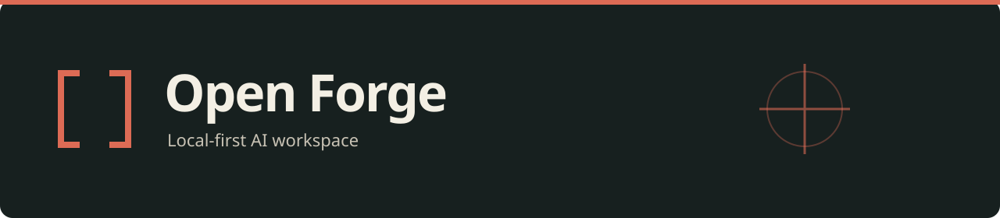

<!-- Modified by The Open Forge contributors. -->
<p align="center"></p>

# Open Forge

[English](README.md) · [简体中文](README.zh-CN.md)

Open Forge is a desktop AI Agent workspace for local and remote projects. It brings project conversations, model connections, file tools, agent teams, and engineering workflows into one application.

This repository maintains the client applications, Agent runtime, CLI, and extension tools. The business backend is maintained separately.

## What you can work with

| Area | Entry |
| --- | --- |
| Projects and conversations | Keep task context and inspect tool execution. [First task](apps/docs-site/content/docs/en/getting-started/first-task.mdx) |
| Engineering workflows | Organize requirements, architecture, development, review, and verification with the bundled [allstar-coding plugin](packages/plugins/presets/allstar-coding/README.md). |
| Agent teams | Coordinate members and follow their conversations and progress. [Team guide](apps/docs-site/content/docs/en/product/agent-teams.mdx) |
| Remote projects | Connect SSH environments and transfer files between local and remote directories. [Environment guide](apps/docs-site/content/docs/en/product/application-environment.mdx) |
| Models and extensions | Configure a provider, then add skills, MCP connectors, plugins, or themes. [Models](apps/docs-site/content/docs/en/product/models.mdx) · [Capabilities](apps/docs-site/content/docs/en/product/abilities.mdx) |

See the [user guide](apps/docs-site/content/docs/en/product/overview.mdx) for knowledge bases, batch tasks, automation, previews, and their conditions of use. Development and acceptance status are tracked in [Project](project/README.md).

## Install or run from source

Download an installer from [Open Forge Releases](https://github.com/hxquan-q/open-forge/releases). Available platforms and architectures are determined by each release's assets.

For local development, install **Bun 1.3.14** and **Node.js 20+**, then run:

```bash
git clone https://github.com/hxquan-q/open-forge.git
cd open-forge
bun install
bun run --cwd apps/desktop dev
```

Configure a model provider in the app, open a project, and start a conversation. Default lite development requires no account or subscription; model services use your own configuration. See [Quickstart](QUICKSTART.md).

The repository is named **Open Forge**. The default desktop distribution displays **Allstr ai** in English and **小爱ai** in Chinese. An explicit `VETTA_BRAND_PROFILE=self` selects the Open Forge display name. See [build modes](docs/desktop/build-modes.en.md).

## Repository layout

```text
apps/       Desktop, CLI, docs site, mobile clients, and transport services
packages/   Agent, model integration, runtimes, capabilities, plugins, and themes
docs/       Engineering manuals and documentation navigation
project/    Requirements, plans, tasks, bugs, research, and verification
scripts/    Development, quality checks, packaging, and release tooling
tests/      Repository-level fixtures and verification support
patches/    Tracked dependency patches
```

Applications consume reusable packages through public exports. The [documentation map](docs/README.md) explains content ownership and links to application and package guides.

## Development

Run these commands from the repository root:

```bash
bun run check:quick              # changed-file lint and architecture guards
bun run test:pkg ai              # focused package tests
bun run test:impact -- <file...> # tests affected by selected files
bun run check                    # full lint, types, and architecture guards
```

Root `bun run dev` watches core libraries. Use the desktop command above to start the app. Contribution requirements and the `dev` PR target are described in [Contributing](CONTRIBUTING.md).

## Data and build modes

Installed builds normally use `~/.openforge`; ordinary development uses `~/.openforge-dev`. Lite provides local sessions, BYOK, and supported local extensions. The optional full build requires a compatible backend configured by the distributor. Brand selection and lite/full are separate settings.

Model providers, MCP connectors, plugins, and other integrations may contact external services. Read [security and data boundaries](apps/docs-site/content/docs/en/reference/security-and-data.mdx), [configuration paths](apps/docs-site/content/docs/en/reference/configuration-paths.mdx), and [SECURITY.md](SECURITY.md).

## Documentation

- [Quickstart](QUICKSTART.md) · [User guide](apps/docs-site/content/docs/en/product/overview.mdx)
- [Developer guide](apps/docs-site/content/docs/en/developers/overview.mdx) · [Plugin manual](docs/plugin/README.md) · [Themes](docs/theme/README.md)
- [Documentation map](docs/README.md) · [Contribution guide](CONTRIBUTING.md)
- [Current release notes](.github/release-notes/v0.1.3.md)

## License

Licensed under [Apache-2.0](LICENSE). Copyright, attribution, and third-party notices are preserved in [NOTICE](NOTICE).
