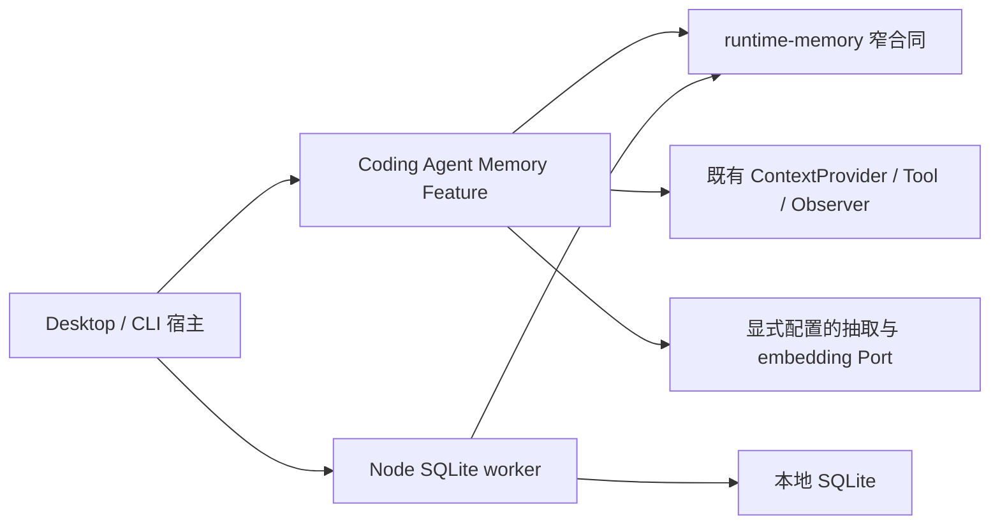
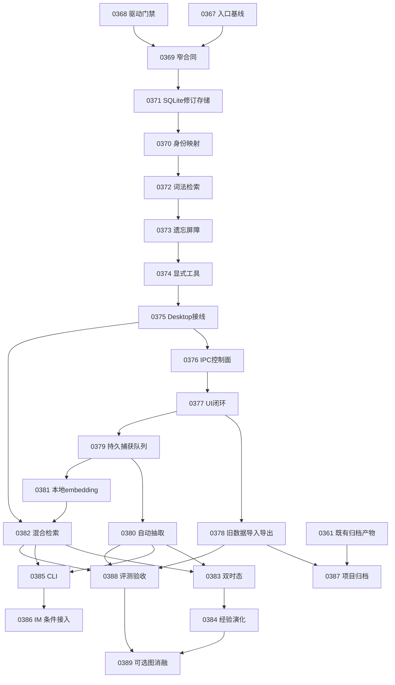

<!-- Copyright The Open Forge contributors. -->

# Agent 持久记忆实施方案

## 背景与目标

承接 [REQ-0027](../requirements/REQ-0027-agent-persistent-memory.md) 和 [RESEARCH-0038](../research/RESEARCH-0038-agent-persistent-memory.md)：让 Desktop 的用户全局偏好、项目决定、任务经验跨会话可用，来源可查、变更可解释、删除不复活。Pi 扩展/桌面源码续研见 [RESEARCH-0039](../research/RESEARCH-0039-pi-memory-implementation-benchmarks.md)。

**推荐：SQLite 事实与修订层 + FTS5/精确检索 + 可选向量召回 + 产品侧 Memory Feature。** Markdown 保留为可审计导出与旧数据入口，不再作为无限事实库。先完成本地可控闭环，再开放自动捕获；图引擎不作为首版前提。

本计划是 `draft`，仅规划；没有进入实施，不执行依赖安装、模型调用、数据迁移或发布。下文新字段、代码目录、阈值和工具均为候选合同。2026-10-22 用户要求出Task后已创建TASK-0367–0389；任务合同真实存在，候选运行代码尚不存在，进入实施仍按Task准入。

## 当前事实

本轮源码基线 `09bc538cb074bd207c93a6245668a751228ba368`；图谱仍为 2026-10-12 的 `254796d8`，已回查目标增量，不能用旧图代替当前接线。没有启动用户 Desktop、读取真实历史或运行模型。

| 发现 | 源码依据 | 对方案的影响 |
|---|---|---|
| 记忆初始设计参考 Hermes，面向 IM 单 owner | [ADR-0009](../../docs/adr/0009-im-gateway-memory-rollover-and-dated-worklog.md) 是原因记录；[IM host](../../apps/im-gateway/cmd/im-gateway/host.go) 当前 `MemoryMode: true`，[CLI argv](../../apps/im-gateway/internal/hostclient/local/client.go) 当前传 flag | “类似 Pi 笔记模式”是形态比较，不能当本仓来源；保留 IM 独立边界 |
| Desktop 正常配置投影未显式传 `memoryMode`，Profile true 不等于启用 | [resolve-session-config](../../apps/desktop/src/main/conversations/resolve-session-config.ts) 构造配置；[selection helper](../../packages/coding-agent/src/composition/runtime-host-session-config.ts) 覆盖 `sessionConfiguration`；[peripheral assembly](../../packages/coding-agent/src/composition/session-initialization/peripheral-assembly.ts) 才检查开关 | 首个切片必须验证真实入口；不是只加一个 SQLite Store |
| 记忆模式同时影响压缩阈值和 rollover | [memory runtime](../../packages/coding-agent/src/memory/memory-rollover-runtime.ts)、[compaction lifecycle](../../packages/coding-agent/src/compaction/runtime/compaction-commit-lifecycle.ts) | 不能直接给 Desktop 打开旧 memoryMode 来启用新记忆 |
| ProjectEntry 只有 path/name，会话空间还存在对话子 cwd、SSH URI | [config](../../apps/desktop/src/main/config/desktop-config-store.ts)、[project service](../../apps/desktop/src/main/projects/project-service.ts)、[session paths](../../apps/desktop/src/main/conversations/session-paths.ts)、[project path](../../apps/desktop/src/main/projects/project-path.ts) | 需要独立稳定记忆身份，不把 UUID/临时 cwd 或 remote URL 当可共享授权 |
| `node:sqlite` 在当前 Desktop bundle 中是不可用垫片 | [shim](../../apps/desktop/src/main/shims/node-sqlite.ts)、[Vite alias](../../apps/desktop/vite.main.config.ts) | 不能选择该 builtin 为现成数据库；驱动与 ABI 是前置门禁 |
| 未在所读 runtime-node/Desktop 生产清单发现现成记忆 SQLite/embedding 依赖 | [Node manifest](../../packages/runtime-node/package.json)、[Desktop manifest](../../apps/desktop/package.json)；lock 中 transformers 来自评测工具依赖 | 不能将开发依赖算作可复用产品能力；不隐式引入模型体积 |
| runtime-node 不得反向依赖 coding-agent，runtime-storage 根入口专注 Conversation | [Node 规则](../../packages/runtime-node/AGENTS.md)、[Storage 规则](../../packages/runtime-storage/AGENTS.md) | 新类型不能定义在产品层后让 Node adapter 反向 import，也不扩大现有 Conversation 根导出 |
| 项目整体迁移另有进行中需求 | [REQ-0026](../requirements/REQ-0026-project-migration.md) | 记忆包导入独立版本化接入，不静默改已有归档协议或夹入全局偏好 |

外部源码交叉验证还发现：Chasen 的 `forgetOnce` 会将 parent 恢复为 latest，观察转换可能纳入 thinking，pre-compact 接线在已核路径只覆盖显式 compact；pi-mind 的 git-common-dir 归并不自动解决分支有效性，pi-hermes 的 repo basename 仍有独立同名仓库碰撞风险。这些直接形成下文遗忘、捕获、身份与宿主验收条件，不能把“SQLite LTM 已存在”当作全部合同已完成。[固定版本与源码证据](../research/RESEARCH-0039-pi-memory-implementation-benchmarks.md)

## 候选方案与取舍

| 方案 | 收益 | 代价/裁定 |
|---|---|---|
| 加大 MEMORY.md + topic 文件 | 易读、容易 diff、现有工具接近 | 并发事务、作用域、来源版本、删除和时态需另造多套规则；仅用于导出/legacy |
| SQLite + 当前产品 Feature | 事务、条件查询、派生索引与故障恢复可组合，便于共用合同 | 新原生驱动和版本迁移成本；**首选**，先验证打包 |
| 直接引入 Pi 扩展 / MemOS local | 有现成捕获与检索实现 | 生命周期、作用域、遗忘与许可未必满足本仓；取机制，不整个搬入 |
| Graphiti / 完整图服务 | 时态图与多跳强项 | 多进程/图服务/语言依赖，不能解决启用和权限缺口；等消融证据 |

### 所有权：一个窄合同包，不另建 Agent 引擎

建议新增 `packages/runtime-memory`，仅放无 I/O 的记录、作用域、修订/遗忘操作、检索端口、Schema、稳定错误及合同 fixture。它不是提炼经验、调度模型或管理会话的另一套框架。

理由是已有实际双消费者 Desktop/CLI，以及 Node adapter 的单向依赖要求。把协议塞进 coding-agent 会迫使 Node 反向依赖产品；把全部记忆塞入 runtime-storage 会混淆 Conversation 的现有所有权；generic metadata SQL Port 又会把复杂持久化知识暴露给全部产品调用者。新增窄包需在实施时按[新增包规则](../../docs/monorepo-new-package.md)完成 exports、workspace、path maps、版本线和边界检查。

| 所有者 | 负责 | 不负责 |
|---|---|---|
| runtime-memory（拟新增） | 可验证的存取合同、scope 限制、版本/遗忘与检索机制合同 | Provider 选择、Prompt、业务重要性、默认用户目录 |
| runtime-node/memory（拟新增） | SQLite、索引、worker、迁移、任务租约和资源释放 | Desktop 配置、用户同意与记什么的产品策略 |
| coding-agent/memory（扩展现有） | 候选抽取、证据等级、冲突裁决、晋升、注入预算、Tool/Feature/Observer | Node I/O、Electron IPC、进程级全局用户状态 |
| runtime-desktop 与应用 Composition | 注入身份/存储/模型 Port、资源生命周期与应用权限 | 复制抽取策略、改 Kernel stop/usage |
| Desktop projects / memory domain | 身份映射、用户控制面、设置、迁移包适配 | Renderer 直接打开 DB 或决定跨项目授权 |

## 身份与作用域

### 稳定身份

- 在宿主指定的用户状态目录创建 installation/profile 下的本地 `principalId`，不绑定凭据正文、不因 Provider 切换而换人，也不假定 Desktop 登录账号与 IM 用户同一身份。
- 在同一 DB 的身份表记录 `projectId(UUID)`、规范化 location alias、authority、可选 repository lineage 和 workspaceViewId。**不立即改变所有 ProjectEntry/cwd/会话主键**；先让记忆解析器独立映射，减少对现有项目/迁移功能的冲击。
- 本地同 authority 下 `git-common-dir` 只用于识别同仓 Worktree；第一次关联时提供可理解的选择。未确认前独立 scope，不能由 repo/remote URL 推出共享权限。
- 已确认同项目的 Worktree 共享项目事实，临时事实绑定 workspaceViewId；branch 名只作标签，fork/branch 会话来源另记 branch lineage。切分支不覆盖别的视图。
- 对话子 cwd 映射到宿主声明的对话空间而非每次 UUID；不存在 Git 的普通目录照常有稳定 projectId。移动目录通过显式重新关联保留 ID；复制/新 clone 默认新 ID。
- SSH location 保留 `(hostId, remote path)` 的既有大小写语义；第一版可存客户端侧命名空间但**不接入远端回合捕获**，不得回落本机目录。未具备远端宿主协议时显示不支持。

### 读取与晋升

持久层约束 `principalId + allowedScopes + agentVisibility + workspaceView + temporalSelector`；这些值由宿主绑定，不由模型或 Renderer 自述。普通项目工具不能指定任意其他 projectId。用户全局偏好、项目知识和 Agent 私有经验分开；“共享同一数据库”不代表开放全部召回。

写入默认当前任务/项目；只有用户明确跨项目偏好，或经用户接受的晋升动作，才进入全局。自动经验先为 candidate/task-local，成功执行证据与稳定适用条件齐全后才升项目；不自动从项目升全局，不自动改仓库规则或 Skill。

## 数据合同与存储

### 首版逻辑表

| 记录 | 关键字段/职责 |
|---|---|
| identity / scope bindings | principal、project UUID、location aliases、view、明确共享关联与变更版本 |
| memory revisions | memoryId、revisionId、kind、content、scope/visibility、status、valid_from/to、recorded_at、supersedes、证据等级、pin |
| source references | canonical session/turn/entry/span 或文档版本、source role、tool outcome、内容 hash、保留许可；不存凭据、thinking、完整系统 Prompt |
| revision-source links | 一条事实可多来源，一段来源可多事实；严格同授权范围，跨 scope 引用需显式动作 |
| current projection | 当前状态与修订指针，可重建；当前值查询不能靠“取最新写入”替代有效时间规则 |
| derived indexes | FTS、向量 BLOB、模型/维度/归一化版本、摘要/关系的依赖 revision IDs 与 scope |
| jobs / ingest cursor | 幂等键、source cursor、状态、attempt、lease、下次重试和稳定错误；任务可重放 |
| erasure / suppression | 不含已忘内容的 source IDs、修订家族/导入标识、撤销 epoch、禁止保留设置；防旧任务恢复记忆 |

先用记录的修订链和有效区间实现双时态：按 valid time 取当时成立的命题，按 known-at 限制系统当时已知修订；迟到更正追加版本，不覆写历史。`valid_to` 为开区间，未知时间显式未知。单值关系才可能冲突；计划/事实、多值关系、不同分支不相互失效。content 相似只作候选，不自动证明同一实体。

“不可变修订”对隐私删除有明确例外：遗忘会清除该家族内容与派生物，只留不含正文的最低审计/抑制信息。模型可建议 ADD / REVISE / RETRACT / NOOP，真正提交前检查 scope、来源、当前版本与撤销 epoch；版本不符重新判断，不能强行 last-write-wins。

### SQLite 驱动与进程

首选 `better-sqlite3`，以窄 Adapter 使用；不选当前被 shim 的 `node:sqlite`，不以开发时运行 Bun 就假定 Electron 能用 `bun:sqlite`。better-sqlite3 的同步接口和 worker 支持见[官方说明](https://github.com/WiseLibs/better-sqlite3)；Electron 原生模块 ABI 必须按目标运行时构建，见[官方文档](https://www.electronjs.org/docs/latest/tutorial/using-native-node-modules)。

每个 profile DB 在同一宿主进程内共用一个延迟创建的 Memory worker，按引用释放，不按项目生成常驻进程。SQLite/索引/向量扫描都不阻塞 Renderer 或 Electron Main。CLI 使用相同协议与 Node adapter，多个进程各持受管理连接，依靠 WAL 事务与数据库 job lease 协调，不能只靠进程内 mutex。

数据库位于宿主解析的 `<agent-state>/memory/<profileId>/memory.sqlite`，不写项目根，不放网络盘；`foreign_keys`、WAL、迁移版本、锁等待、短事务和备份恢复都有明确合同。模型/embedding 调用必须在事务外。SQLite WAL 仍单写者且有网络文件系统限制，不能作为跨设备同步协议。[SQLite 官方 WAL](https://www.sqlite.org/wal.html)

**前置打包门禁**：在隔离临时目录验证目标 Node/Bun 与 Electron 运行时的 nativeBinding、FTS5/trigram、worker、备份和退出；分别 staging ABI 产物，不通过重建共享 node_modules 导致 CLI/其他 Agent 失效。Windows、macOS、Linux 当前支持目标逐一确认；只跑任务需要的最小构建，无模型/用户状态访问。若 driver 无法通过门禁，暂停功能扩大，比较另一种具体驱动，不能静默退成无事务 JSON。

## 用户能力与运行流程

### 1. 与旧 memoryMode 解耦

新增候选 `memoryPolicy`（产品 Session 配置）：`off / explicit / automatic`，含已解析的 identity/scope、读写/捕获权限与模型预算；旧 `memoryMode/memoryFile` 继续解释为 IM legacy rollover 路线。不能把旧 flag 改作新含义。

Desktop 新功能首次启用后默认 explicit：本地读取/明确记住可用；automatic 需选择抽取 Provider/预算，embedding 需选择或下载本地模型。初期 off 为兼容缺省，正式扩大默认前先完成控制面和验收；用户开启一次后按其设置应用于允许的项目，不逐条弹窗。`off` 不读写/捕获但不删除既有数据，项目禁记进一步收紧全局设置。

Desktop `resolve-session-config` 明确解析并传产品配置，runtime-desktop 透传到产品组合；创建/恢复/单 Agent/团队/批量和知识处理任务逐项测试。后台知识处理、评测与 delegated task 默认不得把临时输入写入用户全局记忆；子 Agent 只读父授权 scope，经验由父任务验收后晋升。

### 2. 工具与显式操作

保持旧 `memory` add/replace/remove 的 legacy 输入输出合同，另以版本化新工具提供候选 `memory_remember / memory_recall / memory_get / memory_correct / memory_forget`；不会同时给同一会话两组语义含混的写工具。模型可指定当前项目/任务或允许的全局偏好，不能伪造用户和项目身份。

所有新写入/更正返回稳定 ID、revision、scope、保存状态；correct 需 expectedRevision，有冲突返回可解释的版本错误。recall 返回有界片段、时间、证据等级和 source refs，get 按 ID 分页读授权详情。forget 默认删除该 memory 家族所有版本并阻断旧来源重抽取，**绝不自动恢复 parent 成当前值**；“撤销这次更正”是另一个明确操作，不与遗忘混用。

明确写入失败向调用者报错，不能返回 0 假装成功。自动写入是旁路，失败不改变原 Turn stop，但进入可查看的 failed/deferred 状态。旧文件工具与新结构化工具按会话策略选唯一存储路径，迁移期间不长期双写。

### 3. 捕获与写入

正常完成回合后取已提交 canonical 事件增量；包括用户文本、助手最终可见正文、允许的 tool outcome 与有限证据引用，**排除 thinking/reasoning、系统/开发指令、原始二进制、大段私有工具输出及凭据**。助手说成功只是线索，工具成功/测试通过也只证明它实际验证的范围。

Observer 先把 source IDs/cursor 加入持久队列，不以易丢 fire-and-forget 代替提交。Conversation 与 Memory 是不同事务域，因此用启动/恢复时的高水位对账补获“对话已提交、入队前崩溃”的窗口：仅对已启用 scope、合法保留期和当前分支补获。每项以 source identity + extractor version 幂等，检查 source revision/hash，删除或改写的来源不沿用旧结果。

每 worker 默认一个抽取 job，模型版本/上下文范围/最大输出/日预算均固定于 job；不隐式借用任意主会话模型凭据或循环全量历史。新事实短事务落盘并更新 FTS，embedding 与摘要入可恢复后续 job。重试区分 provider transient、budget、invalid-output、source-revoked；有 attempt 上限/退避，预算耗尽显示暂停，不无限运行。

关掉 automatic 后，不再领取自动 job；检查中的 job 在提交前重检策略/撤销 epoch，防关闭后继续记。压缩前只需持久化待处理来源及必要有界证据，不同步等完整模型/图演化；原始来源保留合同决定是否需复制片段。IM legacy flush 的顺序另做合同测试，不自行改写。

### 4. 检索与注入

先以宿主授权和有效时间约束查询。词法侧采用 FTS5 unicode61 的词项索引、trigram 的连续字符索引和路径/标识符精确字段；**一两个汉字不能只走 trigram MATCH**，官方明确少于三个 Unicode 字符不匹配。短词在已授权/有效行内做参数化 `instr` 扫描并有查询预算，避免 LIKE 的通配符含义；原始查询转义为字面量，不能透传任意 FTS 语法。[FTS5 tokenizer 官方合同](https://www.sqlite.org/fts5.html#the_trigram_tokenizer)

语义侧首版不引原生向量扩展/外部向量库：向量按 modelId/revision、dimension、normalization 存 BLOB，worker 对授权范围内向量分块做精确 cosine，**不是先截词法 top-k 再假装全量向量召回**。可重建索引不改变事实；模型或维度不同的向量禁止混算。容量/耗时超预算时显式退词法，出现实测扫描瓶颈才试 ANN。

本地多语 embedding 候选为 `intfloat/multilingual-e5-small`；作者 model card 记录 MIT、查询/段落前缀要求等，实际 ONNX 产物、量化、运行库兼容及质量尚需固定版本验证，**不把原权重可用等同于已有可发布本地模型**。[作者模型说明](https://huggingface.co/intfloat/multilingual-e5-small)

无 embedding 时保留关键词/精确能力，显示语义检索尚未启用。模型下载需明确选择并走既有资源分发/校验；不因记忆入口首次打开自动下载大模型。远程 embedding/抽取只在用户选择后启用，不默认外发私人记忆。

初始可调建议：词法/向量各取 20 候选，按名单 rank 的 RRF 融合后重检 scope/status/时间，去同源重复，最多 8 条、总计 1,536 tokens（还受当前上下文余量限制）。pin 也占预算；全局偏好不得挤掉全部项目证据。RRF 不直接加原始 BM25/cosine 分数，不能将相似度当可信度。这些是待评测初值，不是已测最优参数。

核心少量显式偏好可稳定入前缀；动态 recall 通过既有 ContextProvider 放到受标记的证据上下文，来源只以数据呈现。外部变化在下一 Turn 固定，Turn 自己的工具修改通过结果可见。不得伪造用户指令、改 stop/usage 或让不可信记忆进入可信 instruction 槽。

### 5. 用户控制与遗忘

用户打开此入口是为了知道 Agent 记了什么、纠正错误或停止保留。全局设置给“记忆”的模式/费用选择，项目详情给当前项目记忆及暂停入口；按用户全局/当前项目切换列表，来源/历史放详情，普通界面不暴露 JSON、vector score 或时态字段名。

列表可搜索并显示内容、适用范围、更新时间；详情能看来源、成立条件、为何记住、历史与更正/忘记。automatic 的日常成功不刷 toast，明确记住/更正给完成反馈；后台暂停和失败可查看。先绘制页面壳再读 DB/索引，保留输入/选择态，可键盘操作，所有文案走 i18n；实现遵循 [用户语言](../../apps/desktop/docs/user-language-ui.md) 与 [异步 UI 顺序](../../apps/desktop/docs/ui-first-async-work.md)。

遗忘事务先提高 erasure epoch、禁止检索并撤销队列/索引引用，再清除事实家族内容、FTS、向量、关系、摘要和缓存；重建/启动对账也检查 suppression。派生摘要含多个记忆时失效并从剩余合法来源重建，不能仅删单条事实。相邻 job 即使模型已返回也须在提交前重检 epoch。

新的模型请求发送前检查撤销版本；在途旧请求已发出的内容无法撤回，界面如实说明边界。检索块和记忆工具结果须携带派生来源标签，模型调用投影过滤已撤销的旧注入/工具结果，不修改 canonical transcript，也不能仅清一个内存缓存。保留的原始会话/旧 legacy 文件不默认被“忘记记忆”删除：明确提供“也处理来源”入口，按用户范围走现有会话/文件删除能力；若继续保留来源则抑制自动重抽取，并说明原会话历史仍可见、原始用户正文不因此消失。用户自行导出、系统备份的副本也不能虚称自动清除。初版无加密 DB/抗磁盘取证承诺；逻辑不可召回与 WAL/备份物理清理分开验收。

## 兼容、迁移与回滚

1. 新策略 off 时旧 Desktop/CLI/IM 行为不变；新记忆和 legacy rollover 正交，跨宿主协议扩展使用可选、版本化产品配置，不往通用 Kernel 塞记忆策略。
2. 按显式路径与 scope 导入 MEMORY.md：保留分隔符/内容原样，标 legacy source hash、缺失时间与未验证来源；Journal 仅作辅助，不能把全部日志当确定事实。导入 ledger 去重，不覆盖用户原文件。
3. 切换后 DB 为新模式唯一事实源；Markdown 按需导出供 diff/检查，不开双向 watcher。原文件后续变化提供明确再导入/冲突预览，不能自动覆盖 DB 或恢复已忘内容。
4. DB schema 单调迁移、先备份、写权限锁与格式标记；旧客户端遇新不兼容 schema 只报不支持，不能自动重建空库。索引模型升级是独立 epoch，可重建，回滚不要求事实降级。
5. 紧急回滚只关新 Feature，原文件不动；新 DB 保留，legacy IM 继续原路径。不能自动用陈旧导出覆盖原文件或把被忘旧事实重新注入。回滚后的新增记忆缺少旧版支持需明确告知。
6. 与 REQ-0026 的归档集成作为独立切片：新版本包只包含明确选择的**项目**记忆、必要来源引用和 suppression，不含全局/Agent 私有数据。迁移可映射原身份，导入成副本默认新 projectId；缺来源显示不可用，历史消息绝对路径不重写。更改归档格式须单独版本与旧版拒绝合同，不能直接改已定义 v2。

## 阶段、依赖与可执行切片

下表保留阶段概览，实际Task已经按下方索引建立，未派发或开工。若实际文件清单超过单次可评审范围，实施前继续拆分，不能为凑小diff丢掉故障/兼容验证。

| 切片 | 用户结果/核心验收 | 主要责任路径（新增均为拟定） | 前置 |
|---|---|---|---|
| S0a 启用基线 | 正常创建/恢复看见真实工具/提示；IM旧行为有基线；新旧记忆与rollover可独立配置 | Desktop conversations、coding-agent memory/composition、现有宿主测试 | 无 |
| S0b 驱动门禁 | 隔离环境通过各目标ABI/worker/FTS；短词用例成立；不改共享二进制 | runtime-node memory prototype、Desktop staging/packaging合同 | 无，可与S0a只读调查并行 |
| S1 身份与协议 | path-only增量映射；Worktree确认关联/副本隔离；版本/擦除合同fixture | 新runtime-memory、Desktop projects绑定、对应合同测试 | S0a/S0b结论 |
| S2 本地明确记忆闭环 | 明确记住→新会话词法recall有出处；更正与并发检查；遗忘/重启/重建不复活 | runtime-node memory、coding-agent显式工具、Desktop composition | S1 |
| S3 控制面与入口启用 | 用户能查看纠正暂停/忘记；创建/恢复/切项目配置一致；错误与页面可恢复 | Desktop memory domain/IPC/preload/i18n、conversations，CLI产品配置 | S2 |
| S4 自动捕获 | 已完成回合增量且不存thinking；崩溃/重放不丢不重；关闭/预算/擦除能阻断旧job | coding-agent capture/extractor、runtime-node jobs/cursor | S2/S3 |
| S5 混合检索 | 固定模型版本的语义召回；中文/路径/错误码与纯词法对照；无模型/超时明确降级 | runtime-node embedding/vector、coding-agent retrieval/ContextProvider | S2/S3；可与S4分独立Task |
| S6 时间与经验演化 | 迟到更正与known-at；分支假设/晋升条件；同预算连续任务净收益 | coding-agent temporal/projector/evolution、runtime-memory合同fixture | S4/S5 |
| S7 宿主与迁移扩展 | CLI/IM明确身份兼容；项目包记忆可选迁移；旧协议拒绝/降级明确 | CLI、IM网关、Desktop归档与REQ-0026接入点 | S3；IM还需独立授权身份设计 |
| S8 可选图实验 | 关系/PPR或概要层的消融有净收益；额外延迟/费用入账；可独立关闭 | memory派生检索实验，非Kernel改造 | S6证明瓶颈后 |

### 已建 Task 与依赖

2026-10-22 按用户“出Task”的要求创建下列23项，未转入实施。两个基础任务ready，其余draft等待前置产物；draft不表示发生阻断，ready不表示已派工。任务frontmatter是依赖/写域/状态事实源，表格仅导航。

| Task | 阶段 | 可验证结果 | 前置Task | 状态 |
|---|---|---|---|---|
| [TASK-0367](../tasks/TASK-0367-memory-entry-compatibility-baseline.md) | S0a | 记忆入口与 legacy rollover 兼容基线 | 无 | ready |
| [TASK-0368](../tasks/TASK-0368-memory-sqlite-native-probe.md) | S0b | SQLite 驱动与多运行时隔离门禁 | 无 | ready |
| [TASK-0369](../tasks/TASK-0369-memory-runtime-contracts.md) | S1 | 记忆协议包与新旧策略合同 | TASK-0367、TASK-0368 | draft |
| [TASK-0370](../tasks/TASK-0370-memory-project-identity.md) | S1 | 稳定项目记忆身份与 Worktree 关联 | TASK-0369、TASK-0371 | draft |
| [TASK-0371](../tasks/TASK-0371-memory-sqlite-revision-store.md) | S2 | SQLite 事实修订存储与资源生命周期 | TASK-0369 | draft |
| [TASK-0372](../tasks/TASK-0372-memory-lexical-retrieval.md) | S2 | 有作用域的词法与中文短词检索 | TASK-0370、TASK-0371 | draft |
| [TASK-0373](../tasks/TASK-0373-memory-erasure-barrier.md) | S2 | 全版本遗忘与防重抽取撤销屏障 | TASK-0372 | draft |
| [TASK-0374](../tasks/TASK-0374-memory-explicit-tools.md) | S2 | 显式记住、检索、更正与遗忘工具 | TASK-0372、TASK-0373 | draft |
| [TASK-0375](../tasks/TASK-0375-memory-desktop-session-wiring.md) | S3 | Desktop 正常会话接线与有界上下文注入 | TASK-0367、TASK-0370、TASK-0374 | draft |
| [TASK-0376](../tasks/TASK-0376-memory-desktop-control-api.md) | S3 | Desktop 记忆管理 IPC 与权限控制 | TASK-0375 | draft |
| [TASK-0377](../tasks/TASK-0377-memory-desktop-control-ui.md) | S3 | 记忆查看、纠正、遗忘与设置界面 | TASK-0376 | draft |
| [TASK-0378](../tasks/TASK-0378-memory-legacy-import-export.md) | S3 | 旧记忆导入、Markdown 导出与回滚 | TASK-0377 | draft |
| [TASK-0379](../tasks/TASK-0379-memory-durable-capture-queue.md) | S4 | 增量捕获、持久队列与崩溃对账 | TASK-0377 | draft |
| [TASK-0380](../tasks/TASK-0380-memory-automatic-extraction.md) | S4 | 受预算约束的自动抽取与事实合并 | TASK-0379 | draft |
| [TASK-0381](../tasks/TASK-0381-memory-local-embedding.md) | S5 | 本地 embedding 资源与版本化向量存储 | TASK-0379 | draft |
| [TASK-0382](../tasks/TASK-0382-memory-hybrid-retrieval-context.md) | S5 | 混合检索、融合排名与注入预算 | TASK-0381、TASK-0375 | draft |
| [TASK-0383](../tasks/TASK-0383-memory-bitemporal-queries.md) | S6 | 迟到更正、历史已知视图与冲突状态 | TASK-0380、TASK-0382 | draft |
| [TASK-0384](../tasks/TASK-0384-memory-experience-evolution.md) | S6 | 经验晋升、软衰减与可重建摘要 | TASK-0383 | draft |
| [TASK-0385](../tasks/TASK-0385-memory-cli-host-integration.md) | S7 | CLI 显式策略与跨会话记忆接入 | TASK-0380、TASK-0382 | draft |
| [TASK-0386](../tasks/TASK-0386-memory-im-identity-adapter.md) | S7 | IM 记忆身份选择与 legacy 兼容适配 | TASK-0385 | draft |
| [TASK-0387](../tasks/TASK-0387-memory-project-archive.md) | S7 | 项目记忆的可选迁移包与副本隔离 | TASK-0378、TASK-0361 | draft |
| [TASK-0388](../tasks/TASK-0388-memory-evaluation-harness.md) | 验收 | 记忆连续流程、质量对照与发布门槛 | TASK-0378、TASK-0380、TASK-0382 | draft |
| [TASK-0389](../tasks/TASK-0389-memory-graph-ablation.md) | S8 可选 | 可选多跳关系或概要检索消融实验 | TASK-0384、TASK-0388 | draft |

执行次序按DAG，不按编号：例如0371必须先于0370。0367是只读基线和记录任务，不顺带改生产策略；新旧记忆/rollover的实际解耦在0369合同与0375接线中完成。0370在0371后使用同一DB，不新造身份文件事实源。

### 交付里程碑

- **M1 本地显式记忆可用**：TASK-0367–0378，包含正常入口、隔离、来源、更正/遗忘、控制面及旧笔记导入回滚；不能只交DB或工具。0377/0378的正常流程证据构成首批验收包。
- **M2 自动混合版**：TASK-0379–0382，加TASK-0388的确定性验收与可复算评测工具。真实模型质量未授权/未跑时如实保留未验证，禁止据此扩大automatic默认启用。
- **M3 复杂记忆与扩展**：TASK-0383/0384提升时态与经验复用；0385/0386/0387分别是CLI、条件性IM接入与项目迁移，不合并成一个大Task。归档任务须核实TASK-0361实际集成产物。
- **M4 可选图实验**：TASK-0389只有在0388证明具体瓶颈后才补输入转ready；不属于首批或自动混合版的默认依赖。

并发只承诺独立写域：0367只读调查可与0368隔离probe并行，记录由Coordinator串行回收；0379完成后0380/0381可各自独立Worktree并行，0381拥有向量表migration，0380不改它。其余共享合同、DB migration与宿主集成串行。scope冲突已登记到各Task，真正派发前仍须全库worktree门禁；任务目录目前无新Worktree或派发。

**首个可用版本交付S0–S3，完整自动混合版交付到S5；不能把仅有DB/内部工具称为用户闭环。** 双时态字段和来源从S1保留，基本更正/当前值从S2必有，S6只补复杂推理和经验演化。原始历史默认不自动回填；批量/知识处理不作为个人记忆学习源。

并发结论为**条件支持**：本轮只有主会话串行编写任务，无后台研究或并行代码写入。可并行任务及共享路径以任务合同和上述DAG为准；实施并行按每Task独立Worktree，不在同检出目录平行改代码。

## 窗口派工（Coordinator 维护，仅调度）

本段由窗口 A Coordinator 单独维护，只用于双窗口并行调度与交接对账，不替代 Task frontmatter 的正式状态。两窗口不跨对话通信：B 窗口以本段（读本地 `main` 最新提交）与各自 Task Worktree 内的交接文件为唯一派工事实源。本批派发范围：TASK-0367–TASK-0382 与 TASK-0388；TASK-0383–0387、TASK-0389 不派发。

状态取值：`preparing`（合同落盘中）→ `assigned`（B 可开工）→ `delivered`（B 已交付待审查）→ `reviewing` → `returned`（退回修复，代次+1）→ `integrated`。B 开工前置：本行状态为 `assigned`、Task 编号与本行一致、Worktree 实际 HEAD 等于本行 base commit。候选 commit 必须落在该行 branch 上；A 侧任务不使用交接文件。

| Task | 窗口 | 派工代次 | 状态 | base commit | branch | Worktree 绝对路径 | 交接文件路径 | 候选 commit | 集成结果 |
|---|---|---|---|---|---|---|---|---|---|
| TASK-0367 | A | 1 | integrated | 9bb2d8a77 开工基线（取证见 VERIFY-0020） | main | 主工作区（coordination-only） | — | 承载提交即绑定（VERIFY-0020 + Task done/integrated） | integrated |
| TASK-0368 | B | 1 | integrated | 8c07b195b（分支实际父，含 802233321；交接报告基线写 9bb2d8a77→视为 802233321，落后一个冲突登记提交，已核实无实质偏差） | task/TASK-0368-memory-sqlite-native-probe | C:\Users\xquan\Desktop\open-forge-wt\task-0368-memory-sqlite-native-probe（已集成，待推送后清理；物理 Worktree 本批保留） | project/verification/HANDOFF-TASK-0368-window-b.md | 5637b2e95 + 73cd79f56 | integrated（--no-ff 合入本地 main；复验全绿） |
| TASK-0369 | A | 1 | integrated | 537af264e 开工基线 | main | 主工作区（serial） | — | 承载提交即绑定（含 ADR-0149/0150） | integrated（完整 check 全绿） |
| TASK-0371 | A | 1 | integrated | 777539cb4 | main | 主工作区（serial） | — | 承载提交即绑定 | integrated（563 例 + staging 验证全绿，完整 check 绿） |
| TASK-0370 | A | 1 | integrated | 17861fae7 | main | 主工作区（serial） | — | 承载提交即绑定 | integrated（13 例定向 + 完整 check 绿） |
| TASK-0372 | A | 1 | integrated | 5341cff2f | main | 主工作区（serial） | — | 承载提交即绑定 | integrated（572 例 + 完整 check 绿） |
| TASK-0373 | A | 1 | integrated | cc6f698af | main | 主工作区（serial） | — | 承载提交即绑定 | integrated（576+38 例与完整 check 绿） |
| TASK-0374 | A | — | 未派发 | — | — | — | — | — | pending |
| TASK-0375 | A | — | 未派发 | — | — | — | — | — | pending |
| TASK-0376 | A | — | 未派发 | — | — | — | — | — | pending |
| TASK-0377 | A | — | 未派发 | — | — | — | — | — | pending |
| TASK-0378 | A | — | 未派发 | — | — | — | — | — | pending |
| TASK-0379 | A | — | 未派发 | — | — | — | — | — | pending |
| TASK-0380 | A | — | 未派发（0379 集成后） | — | — | — | — | — | pending |
| TASK-0381 | B | — | 未派发（0379 集成后，届时建独立 Worktree 与交接文件） | — | — | — | — | — | pending |
| TASK-0382 | A | — | 未派发（0380/0381 集成后） | — | — | — | — | — | pending |
| TASK-0388 | A | — | 未派发（0382 集成后） | — | — | — | — | — | pending |

派工备忘（由 Coordinator 续记）：

- 2026-10-22 事故与修复：9bb2d8a77 无 pathspec 提交曾把并发会话暂存的六行他人未提交索引改动（PLAN-0022/REQ-0028/RESEARCH-0040/0037/TASK-0365/0366）卷入提交；802233321 已从已提交索引移除六行并原样归还工作区未提交状态，未动他人未跟踪记录文件。教训：共享索引无锁，本批所有提交一律带 pathspec。
- 2026-10-22：TASK-0368 登记 conflicts_with TASK-0197（其合同声明 project/tasks 整目录写域且仍为 in_progress/parallel，写域检查在 0368 声明 Worktree 后判负）；仅调度登记，0197 实际已无活动 Worktree。B 的 Worktree 分支已快进到 802233321 之后的最新 main。
- 2026-10-22：TASK-0368 审查与集成（Coordinator）：合同测试 15/15、`--help`、全矩阵 probe（node 26.3.1/bun 1.4.2/electron 41.10.7 × 12 检查，退出码 0）均独立复现；diff 严格在写域内。集成验证中 `scripts/agents/runner.test.mjs` 与 `scripts/quality/desktop-release-workflow.test.mjs` 各 1 例红，已在批前基线 7bf921977（独立 Worktree 复跑）确认同样红：desktop-release-workflow 为 Windows 临时目录 rmSync EPERM（环境问题），runner 为已登记时序 flake（单跑绿）；均与本批无因果，不阻塞集成。另：应用 origin/dev 已合入的 7326aa159 同内容声明头修复（d25bc1380），消除 main 基线 check:guards 红，保障后续完整 check 可判读。

- 2026-10-22：TASK-0368 原合同 write_paths 中的 `.github/release-notes/fragments/v0.1.3/task-0368-memory.md` 与仓库发布说明事实不符——`v0.1.3.md` 为手写正文（无汇编标记），与碎片共存会被 release-notes 门禁判负。派工前已将该路径从合同移除，改为：B 不写发布说明，Coordinator 在集成提交按交付规则更新 `v0.1.3.md`。
- 2026-10-22：`bun run worktree:check --all` 在本批之前即因 TASK-0344–0347 的日期格式与若干历史 worktree 声明漂移而红（先存事实，非本批造成）。本批派工改用 `worktree:check --task <ID>` 定向门禁 + 逐 Task 核对，不动他人记录。
- 2026-10-22：编号占用事实——`origin/dev`（5833041dc）已合并占用 TASK-0367 编号的 PR #21（desktop-macos-test-workflow）与 TASK-0368 分支名的 PR #22（notice-activity-panel），本地 `main`（2f9d42762）落后 `origin/dev` 且主工作区含他人未提交内容。本批仅本地集成、不推送；未来同步 `origin/dev` 时需先处理台账撞号（两个 TASK-0367 文件同库会被 project-indexes 判 duplicate）。本批不合并 `origin/dev`。
- 2026-10-22：TASK-0368 Worktree 已由 `worktree:create` 从 main@9bb2d8a77 创建（branch/task 同名，依赖安装完成，`worktree:check --task TASK-0368` 通过）；任务状态转 in_progress，B 可开工。TASK-0367 同步转 in_progress，由 A 在主工作区执行。
- 2026-10-22：A 侧串行任务按 0369 → 0371 → 0370 → 0372 → 0373 → 0374 → 0375 → 0376 → 0377 → 0378 → 0379 → 0380 → 0382 → 0388 的依赖序推进；TASK-0369 准入需 0367 与 0368 工程证据齐备。

## 验证与回滚

| 验证层 | 必须证明 | 未来命令/入口 |
|---|---|---|
| 纯合同/领域 | scope/时间/版本/擦除/排名/预算不变量及异常输入 | 定向runtime-memory与coding-agent测试，仓库Node runner |
| SQLite真实临时库 | 重启、事务、并发、job lease、迁移/备份、FTS双索引、删除衍生依赖 | `bun run test:impact -- <实际测试与源码路径>`，走仓库runner |
| 宿主连续流程 | 正常创建→记住→退出→恢复→更正→换项目→忘记→重建；IM停用/rollover不被混淆 | Desktop/CLI既有RuntimeHost合同；必要Go包工具链 |
| UI合同 | 查看/纠正/遗忘与反馈、初始/空/失败/部分/暂停状态，UI先于昂贵准备 | Desktop组件/IPC/preload合同；不默认verify:ui |
| 固定离线夹具 | 短中文1/2/3字、路径符号、错误码、来源撤销与越权查询，零已知违规 | 合成语料，非用户历史；确定性模型/embedding fake仅替代外部边界 |
| 模型质量 | 同模型/预算/候选数对照无记忆、当前摘要、词法、向量、混合；实际可执行成功率/重复失败 | 用户授权后独立VERIFY，不把mock测试当模型成绩 |

实现每片做定向测试与test:impact，完成代码任务运行完整 `bun run check`；需要构建仅运行该片必要目标。新包完整检查含导出/边界/版本线；Native验证不得借用用户当前进程或状态。真实Provider、付费评测、UI验证仍按仓库授权规则。

建议初始评测规模为每scope 1k/10k事实、不同长度中文与英文混合、两宿主并发、冷/热查询；以所用硬件和维度记录结果，不把开发机成绩写成通用SLA。10k × 384 × Float32仅向量原始体积约15.36MB（算术估算，不含索引/对象/模型）；不能据此承诺应用总内存。查询采用可配置软deadline，结果不足/超时不放宽scope、不返回已撤销缓存。

硬门槛是隔离/来源/版本/删除/错误语义正确；质量与性能门槛在S0基线后登记VERIFY：混合不能仅提升QA分数而降低同预算任务成功，后台成本必须计入总账。阈值未定不阻止本轮形成方案，但禁止实施时自降基线。

## 不做什么与升级信号

首版不做全局图服务、LLM多级无限反思、无预算全历史抽取、默认后台模型下载、跨设备实时DB同步。没有本地embedding时词法能力正常但如实标部分可用。

多跳错误占主要失误且关系索引消融有收益时才试PPR；全局主题任务明确需要时试项目概要；授权范围向量扫描成为实测瓶颈时试ANN；多设备冲突确有需求才设计同步协议。任何“升级”都不得越过scope/删除/费用门槛。

## 需要的 ADR 与待定决策

实施前建议各记录一个真实跨模块决定：① memoryPolicy与legacy rollover解耦；②窄runtime-memory合同包、SQLite事实源和版本化导出；③身份/Worktree关联/跨宿主授权。归档扩展与REQ-0026协同，不能把候选方案伪装为已生效ADR。

不需要用户现在填技术问卷。仍需S0取证收敛的内容：目标driver版本/各运行时ABI、embedding具体可发布产物和授权下载路径、性能基线，以及IM身份是否与个人共享。默认按本地、隔离、不扩大外发、IM legacy保留推进；这些结论变化时更新本计划再进入相应切片。

## 本轮交付与验证事实

上一轮产物为Requirement、候选Plan和续研证据及索引；未修改运行代码或生成正式ADR。本轮按用户要求创建23份Task并同步关联，仍未开工。外部一手来源与具体可取/不可取实现以RESEARCH-0039为准。

上一轮方案文档验证（2026-10-22）：只读Node脚本检查7份当轮管理记录/索引，最终160个本地相对链接全部存在，LF、必填frontmatter与围栏检查通过；外部引用按研究逐项读取，不声称机械复检全部外链。`node scripts/quality/check-project-indexes.mjs` 通过；三个已跟踪目录索引的 `git diff --check` 通过，未跟踪正文另按实际文件读取校验。

上一轮 `bun run test:impact -- <当轮7份管理记录/索引>` 退出0，明确报告无受影响可测试代码并跳过；不表示行为测试已跑。纯方案未运行完整 `bun run check`、模型评测、原生驱动、UI/打包或数据迁移验证。

### Task 台账交付验证（2026-10-22）

- 新增TASK-0367–0389共23份：2项ready、21项draft；关联需求/计划及三个导航索引同步。没有创建Worktree或执行实现。
- `node scripts/quality/check-task-worktrees.mjs` 退出0：全库382个Task合同通过，0 warning；`node scripts/quality/check-project-indexes.mjs` 退出0，Plan/Task状态索引匹配。
- 只读Node脚本检查本轮28份文件：217个本地链接存在、LF/尾空白/结尾换行/围栏及Task frontmatter检查通过；依赖引用存在且无环，批次内冲突双向登记，两组候选并行写域无重叠。该检查不等于实际Worktree派发门禁。
- 三个已跟踪目录索引的 `git diff --check` 退出0；新建正文已按实际文件读取检查。
- `bun run test:impact -- <本轮28份管理记录/索引的明确路径>` 退出0，报告 `no affected testable code; skip`，没有执行行为测试。
- 未运行完整代码检查、原生驱动probe、模型评测、UI/打包或真实数据迁移；这些是未来Task要求。计划保持draft，本轮仅交付任务合同，未提交或推送。
