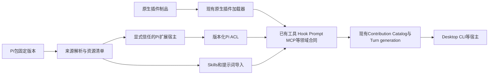

<!-- Copyright The Open Forge contributors. -->

# Pi 生态接入与原生插件演进方案

## 背景与目标

来源：[REQ-0028](../requirements/REQ-0028-pi-ecosystem-and-plugin-evolution.md)、[Pi官方与生态固定版本研究](../research/RESEARCH-0040-pi-extension-ecosystem-compatibility.md)。目标是让用户实际复用Pi生态，同时保留Open Forge的桌面插件、多宿主和权限模型。

推荐保留现有原生插件与Coding Extension机制，通过版本化Pi适配层导入资源和映射行为，形成统一管理入口。不要替换内核，也不要把Pi扩展包装成空React插件后宣称完成兼容。首个可用版本必须覆盖安装、启用、执行、恢复和卸载；不以loader fixture通过作为交付。

本轮只调查和制定方案，未建立实施Task、未修改运行代码。计划保持draft，待实施时再把每阶段拆成有写域、测试和兼容门禁的Task。

## 当前事实

调查源码基线：`2f9d42762e2638601c5907bb1edfd88b36e0e68c`。工作区已有其他人的浏览器/CI等改动，未改动它们。`.ua`图谱为2026-10-12、`254796d8`，17009节点/35740边；图谱较旧，目标目录增量已核对并回读源码，不重建图谱。

### 已有能力与真实缺口

| 领域 | 当前源码事实 | 对方案的含义 |
|---|---|---|
| 原生桌面插件 | [manifest schema](../../packages/plugins/plugin-sdk/src/manifest-schema.ts)要求entry和moduleFederation；[parser](../../packages/plugins/plugin-sdk/src/manifest.ts)明确拒绝runtime字段 | 当前不是通用Node扩展容器；纯资源/无UI能力不能靠随便补runtime字段接入 |
| 版本合同 | SDK npm版本0.3.12；[宿主API版本](../../apps/desktop/src/main/plugins/plugin-api-version.ts)2.10.0 | SDK、宿主API、Pi profile、包版本必须分别记录，不能混为“插件版本” |
| 原生贡献 | SDK已有工具、Hook、Skill、MCP、Agent/Team、Prompt、Continuation及丰富UI；[运行时source](../../apps/desktop/src/main/plugins/coding-agent-plugin-runtime-source.ts)统一动态发布 | 不再造另一套插件工具/Hook runtime；复用已有域合同和generation |
| 激活与释放 | [loader](../../apps/desktop/src/renderer/domains/plugins/runtime/plugin-loader.ts)有activationId、注册完成等待、提交、失败清理和私有capability session | 已有局部事务和清理，优化应扩展此边界，不能泛称“没有生命周期” |
| last-known-good | [snapshot](../../apps/desktop/src/renderer/domains/plugins/components/plugin-snapshot.ts)加载失败保留旧实例；[host](../../apps/desktop/src/renderer/domains/plugins/components/PluginGlobalSlotHost.tsx)先发布新贡献再释放旧实例 | 已有内存态回退；它不等于磁盘安装与重启恢复的事务 |
| Hook安全更新 | [registry](../../apps/desktop/src/main/plugins/coding-agent-hook-registry.ts)有lease、retired generation、hard revoke和诊断 | 保留在途调用语义；权限硬撤销与普通更新必须区分 |
| 授权升级 | [plugin-package](../../apps/desktop/src/main/plugins/plugin-package.ts)新声明与旧授权取交集，新增权限不自动授予 | 这项已实现；Pi接入应保持，不能重新默认全授予 |
| 安装落盘 | [catalog](../../apps/desktop/src/main/plugins/plugin-catalog.ts)校验/复制后改activeVersion并广播；[copy](../../apps/desktop/src/main/plugins/plugin-package.ts)同版本目录先删再拷；[store](../../apps/desktop/src/main/plugins/plugin-registry-store.ts)直接写JSON、读异常返回空对象 | 需要故障恢复、不可变制品和原子registry发布；先做复现，不直接定性为已触发数据丢失Bug |
| 包获取 | [plugin-cli](../../packages/plugins/plugin-cli/src/npm-package.ts)已有npm pack --ignore-scripts、路径/包身份和包内archive校验；[npm schema](../../packages/plugins/plugin-sdk/src/npm-package.ts)要求package.json#vetta | 已支持native npm分发，但不是Pi的package.json#pi资源发现和依赖安装流程 |
| 信任模型 | [权限文档](../../docs/plugin/permissions.md)明确插件与宿主同renderer realm，权限是SDK门控而非沙箱 | 第三方Pi Node源码不能直接装进renderer；Node进程本身也不是安全沙箱 |
| Pi兼容基础 | [独立公开子路径](../../packages/coding-agent/package.json)、[contracts](../../packages/coding-agent/src/extensions/pi-compat/contracts.ts)已有pi-extension-0.84-host-neutral-v1与五种兼容状态 | 不是零基础，也不是已覆盖当代生态；保留旧profile，增量建立新目标 |
| Pi行为缺口 | [factory](../../packages/coding-agent/src/extensions/pi-compat/factory-adapter.ts)有事件allowlist，拒绝flag/provider/events；终端renderer/shortcut标excluded；未知API报错 | 缺少的不是只有UI；常见初始化事件、command和会话行为也会影响真实包加载 |
| Pi生产入口 | [Pi loader](../../packages/coding-agent/src/extensions/pi-compat/loading.ts)未找到普通宿主调用；[Desktop资源入口](../../apps/desktop/src/main/agent-runtime/resource-runtime.ts)关闭extensions/prompts/themes | 优先建立显式来源/profile选择和正常入口闭环，不能只继续堆facade方法 |
| 资源包发现 | [resource-discovery](../../packages/coding-agent/src/resources/packages/resource-discovery.ts)已读取package.json#pi；[projection](../../packages/coding-agent/src/resources/packages/resource-projection.ts)已有extensions/skills/prompts/themes和约定目录；source runtime已有local/npm/git及user/project/temporary scope | 不重写包发现；补强类型化origin/profile/trust/锁定版本，并把其传入执行层 |
| 资源解析的副作用 | [package-source-runtime](../../packages/coding-agent/src/resources/packages/package-source-runtime.ts)解析缺失包可触发安装；[package-lifecycle](../../packages/coding-agent/src/resources/packages/package-lifecycle.ts)存在npm install、user scope npm install -g与Git包npm install | “预览/检测”不能直接调用完整resolve路径；新增无副作用inspect，安装与脚本授权必须分开 |
| 原生会话和UI | [session投影](../../packages/coding-agent/src/adapters/extensions/runtime-session-view-adapter.ts)已有branch/tree；[context host](../../packages/coding-agent/src/extensions/runtime/context/extension-context-host.ts)部分未绑定命令默认返回cancelled:false；Pi facade未开放对应写API | 优先复用真实会话Port；缺能力必须明确拒绝，不能把成功形态NOOP投射给Pi包 |
| 文档漂移 | API版本文件/插件规则称未知manifest字段fail-closed；实际顶层schema additionalProperties:true，parser重建已知字段，另特拒runtime | 应先为顶层/嵌套/扩展字段定义统一合同，再同步Schema、文档与测试；不直接改成全拒绝造成存量破坏 |

加载响应的具体观察：[snapshot](../../apps/desktop/src/renderer/domains/plugins/components/plugin-snapshot.ts)聚合所有启用插件的Promise，host等待整批后发布；单个永不resolve的activate可能拖住批次。所读路径未见激活deadline，属于应通过挂起fixture验证的风险，不声称已运行性能实验。Promise.race也不能中断同realm同步死循环。

### Pi兼容分级

Pi当前固定版本、真实生态样本和详细API差异见研究，不把main快照自动当成发布tag，也不把历史0.84 profile称为最新版兼容。

| 资源/行为 | 建议首批处理 | 不能作出的承诺 |
|---|---|---|
| Skills、prompt templates | 非执行导入，保留原文件、相对资源、来源和命名空间；处理frontmatter/调用差异 | 文件能导入不等于其中脚本已授权可执行 |
| 纯工具与事件 | 受信任扩展宿主 + native合同映射 + 固定profile样本验证 | execute参数数量相同不代表ctx、返回值和动态注册语义相同 |
| 会话/持久条目 | 映射到现有ConversationDocument/Session Port，验证branch、custom entry与恢复 | 不能用空getBranch、内存Map或NOOP appendEntry伪装兼容 |
| Command、dialog、通知 | 提取宿主中立交互并由Desktop/CLI适配；显式hasUI/mode能力协商 | RPC支持dialog不代表支持Pi自定义终端组件 |
| Provider/OAuth/request hooks | 先明确所有权、撤销、内置恢复与凭据边界；已有支持交集才开放 | 不把provider config注册当完整动态Provider/OAuth生命周期 |
| TUI组件、renderer、terminal shortcut、终端theme | 标unsupported/excluded；有价值的单独移植为原生桌面功能 | 不将ANSI/Component函数自动转换为React，不静默剥离关键交互 |

## 候选方案与取舍

| 方案 | 收益 | 代价/问题 | 结论 |
|---|---|---|---|
| 整体嵌入Pi Agent runner | 表面API更接近 | 第二套Session/Tool/Provider/权限/持久化核心；长期双重所有权 | 否决 |
| 只做npm import alias | 小fixture容易跑 | 无资源发现、事件/会话语义、生命周期、版本和信任合同 | 否决 |
| 每个Pi包改成原生React插件 | 能深度结合桌面UI | 所有包都要维护fork，纯资源也背负MF构建 | 仅用于少数高价值UI移植 |
| 原生域合同 + Pi ACL + 包来源适配 | 复用现有机制，可逐项扩大兼容，有明确失败边界 | 初期必须做版本/行为矩阵和产品入口 | 推荐 |

这是职责示意，不是新建统一万能PluginRuntime。包解析复用既有资源source/discovery/projection，但必须拆出无副作用inspect。Pi源码在环境宿主加载，Pi行为映射留在coding-agent；runtime-node不反向import产品Pi类型。Desktop只组合入口和交互Port。

### 建议包与作用域模型

统一管理页可以展示不同来源，但执行模型不混同：native desktop plugin、Pi resource bundle、Pi executable extension分类型保存。不要制造空MF入口；先用独立Pi来源记录，后续原生headless manifest另行版本化。

候选记录包含：内部稳定packageId、origin/spec、resolvedVersion/commit、artifact hash、dependency lock digest、资源清单、profile/host target、trust decision、scope、启用项、实际loaded generation和diagnostics。现有ability ledger/native registry仍各自是当前领域事实源；是否抽取共同安装记录取决于第二来源接入时的实际重复，不预建一套重复数据库。

项目安装与用户安装、启用范围必须分开；项目/Worktree关联使用既有项目身份，不另造依赖remote URL的身份系统。对话固定Turn generation；普通更新下一Turn生效，hard revoke按现有审计和检查点处理。禁止让workspace里的包配置自行把代码提升成已信任。

### 新profile的最小行为集

现有0.84 profile保持明确边界；建议新增以研究固定1.4.0快照为目标的profile，名称与精确版本在S0确定，不能直接修改旧profile含义。先写native合同和差分夹具，再开放Pi映射。

| 优先级 | 候选能力 | 必须证明 |
|---|---|---|
| 首批 | import facade、registerTool、输入校验、update/result/cancel | 实际依赖与虚拟模块一致；不支持的parallel、structured output、exposure、嵌套executeTool明确拒绝或有已声明的可降级路径 |
| 首批 | session_start/shutdown、before_agent_start及既有工具/context事件 | 事件生产者、顺序、门控/变换返回、unsubscribe和generation清理；同名不能直接视为等价 |
| 样本驱动 | registerCommand、exec、appendEntry、sendMessage/sendUserMessage | 命令ctx与事件ctx分开；进程权限/取消；持久化和消息角色正确；执行失败不回成功形态NOOP |
| 样本驱动 | getBranch/getEntries/tree及分支状态恢复 | 当前分支根到leaf顺序、其他分支隔离、fork/恢复和旧ctx失效 |
| 下一批 | confirm/select/input/editor、notify和文本status | 宿主能力检查、取消/超时/断开；hasUI不意味着支持custom TUI |
| 独立批次 | Provider、flags、跨扩展events、SDK级createAgentSession | 注册事务、凭据/所有权、卸载恢复与单一Session事实源；无法表达时保留unsupported |

对真实样本按extension文件/功能分级，不把一个包中某个资源可用宣传为整包兼容。pi-skills可优先验证资源导入；web-access工具、pi-memory的生命周期和amplike的门控交互可作为后续合同输入，均不是本轮已运行或已兼容的承诺。SDK级subagents与MCP adapter已有本仓对应领域，优先复用协议/功能，不另起第二套Agent或MCP连接所有者。

### 来源与信任路径

1. 复用已有local/npm/git来源解析，首批产品入口先开放显式本地包/固定registry版本；Git来源在相同归档/路径校验后扩展。不扫描并执行真实Pi用户目录，不沿用user scope全局npm安装或解析时自动安装作为安全预检。
2. 在隔离staging中读取package.json和资源，不import模块、不运行prepare/postinstall。静态列出显式依赖和风险，但标明动态import不可完全预测。
3. executable extension首期只面向明确选择的可信代码，显示Node文件/网络/进程能力可绕过SDK这一事实。与原生renderer分进程可改善崩溃/资源回收，不宣称OS隔离。
4. 资源包无需为了读取Markdown获得可执行代码信任。第三方dependency需要安装脚本时单独决策；首批不自动开放脚本或全量peer依赖安装。
5. 若未来要求未知第三方受限执行，另立OS权限、网络、文件、凭据和子进程威胁模型；不能仅加worker便宣传安全沙箱。

## 阶段

| 阶段 | 交付的用户结果 | 必需门槛/证据 | 依赖 |
|---|---|---|---|
| S0 兼容基线与合同 | 用户能知道指定包为何支持/拒绝 | 固定官方版本及样本SHA；API/事件/宿主矩阵；正常入口和信任边界；静态检查不执行JS | 无 |
| S1 资源接入闭环 | 选择Pi包→预览Skill/提示词→选择范围→启用→重启→卸载 | 相对资源/命名冲突/锁定版本/越界路径/项目隔离；无第三方JS执行 | S0 |
| S2 工具扩展闭环 | 一个受支持真实Pi工具包经普通Desktop入口可调用、取消和恢复 | 可信扩展宿主、profile选择、最小事件、更新/禁用；有状态样本的appendEntry与必要session初始化事件必须在本阶段完成，不推迟到S3；真实包与合成fixture | S0、S1 |
| S3 行为扩展 | 根据已选样本补command、session事件、结构化UI，再考虑Provider | 每项先有native合同、再Pi映射；失败/重入/恢复差分；不假造不支持能力 | S2 |
| N1 原生安装恢复 | 安装失败/中断后保留最后完整插件状态 | 内容不可变或hash制品路径、staging/原子registry发布、损坏隔离/恢复、并发安装锁、权限差异 | S0；可与S1不同写域并行 |
| N2 加载与诊断 | 一个插件挂起时其他已就绪能力可见，能看见失败原因 | 限并发、deadline/取消合作、迟到提交拒绝；逐插件状态；加载时长、generation、lease、错误码 | N1或先独立行为基线；不与同一loader写域并行 |
| N3 原生无UI贡献 | 纯Skill/MCP/工具无需伪造React入口 | 新版manifest判别分支、旧MF兼容、资源/授权/SDK/文档同步；必要ADR | S2验证实际需求后 |
| S4 可选桌面移植 | 少数高价值TUI扩展有原生桌面体验 | 独立需求、维护成本、交互合同；不更改通用兼容承诺 | 有具体用户价值和样本 |

首批推荐做到S2并交付N1/N2的高风险改进；S3按真实包缺口选取，不用一次补齐所有Pi API。S0不等于长期只做研究，S1/S2必须是完整用户流程。

### 原生系统优化优先级

1. **P0 可恢复安装与版本一致性**：原生安装不是没有校验，问题在落盘发布、同版本覆盖、损坏反馈和重启后的回退证据。不要恢复历史“装完显示新版本、实际仍跑旧版本”的隐形pending状态；installed/selected/loadedVersion必须同时可见，状态机有显式恢复流程。
2. **P0 统一兼容诊断**：复用现有日志、Hook lease诊断和capability readiness；管理页与CLI doctor展示来源、版本、profile、阶段、activation/generation、缺权限、缺二进制、最后失败及可恢复动作。当前CLI已有docs/add/reload/watch/sync等，不为diagnostics重写CLI。
3. **P1 按需激活与批次解耦**：先测启用插件数/冷启动/挂起fixture，保留已就绪快照；启动条件按贡献类型设计。纯注册类可预加载，重资源UI/进程按需。不能靠删插件或将所有逻辑丢后台来改变功能语义。
4. **P1 manifest与SDK一致性**：先定义未知字段兼容策略并覆盖存量包；明确必要字段与optional capability。同步docs/plugin、SDK changelog/version、宿主API和适用文档站；版本号不再等同支持能力集合。
5. **P1 无UI插件与开发验证**：支持真实agent-only贡献后，工作台增加check/compat report/生命周期fixture模板；保留现有init/watch/docs和MF共享约定。
6. **P2 依赖与服务图**：只有真实包需要跨插件服务依赖时，增加必要/可选依赖、版本范围、循环检测和依赖失活语义。现有Agent Team跨插件引用不自动证明通用服务依赖已存在；不先引入Cordis或全局服务容器。

## 验证与回滚

- 版本矩阵：旧0.84 profile、新目标profile分别验证；Native/Pi、Desktop/CLI分开。固定真实样本SHA/依赖锁/平台；未安装运行的样本只标源码审阅。
- 软件合同：工具参数/TypeBox facade、流式update/structured output、error/cancel/usage/stop、事件注册和卸载、command返回、会话branch与条目恢复、重名工具、generation与hard revoke。
- 产品流程：普通Desktop入口安装→启用→调用→切项目→退出恢复→升级失败→禁用；安装目录与状态均使用临时fixture。
- 故障注入：copy/registry写中断、损坏JSON、同版本并发安装、async activate挂起、迟到回调、旧generation释放、Renderer重载。不得用Promise timeout宣称中断同步恶意代码。
- 真实生态：对研究样本分类，先选能覆盖工具、session事件、状态和进程的真实包；可先用其固定资源构造审核后的fixture。真实第三方模块执行需要信任准入，不在本轮运行。
- 质量指标：样本按“可加载/可完成用户流程/降级/不支持”分别计数，记录失败原因；不以star数量或厂商百分比推断兼容率。加载性能记录冷/热p50/p95、内存/进程数及硬件条件，先测基线再设目标。
- 实施时定向测试、test:impact、适用构建及完整bun run check按仓库规则执行；UI验证、Provider和模型费用另按授权，不能用Mock成绩代替真实行为。
- 回滚：按来源/profile关闭Pi可执行扩展，保留已审核资源与用户配置；恢复最后完整制品和registry，索引可重建。旧原生MF插件和现有会话可继续工作；禁止自动恢复已撤销授权。

## 不做什么

不替换内核、不再造Hook/Tool/Session事实源、不统一渲染Pi TUI、不恢复退役架构、不自动下载/运行第三方源码、不一口气移植全生态。项目市场后台属于独立服务端仓库，本计划只设计本仓客户端与公开分发合同。

## 升级信号

S2样本经行为验证后，若主要失败集中于command/session/UI，再定向做S3；不能按API方法数扩展。若用户明确需要未知第三方代码，单独设计真正安全隔离。只有性能基线证明全量激活为主因时扩大按需激活；只有实际服务依赖出现才引入依赖求解。

## 需要的 ADR

实施时记录三类真实决定：①目标Pi profile及可见性/持久语义映射；②Pi来源记录、执行宿主与显式信任模型；③原生headless manifest和可恢复安装协议。参考[ADR-0063](../../docs/adr/0063-vetta-native-extension-contributions-before-pi-compat.md)、[ADR-0064](../../docs/adr/0064-desktop-plugins-use-coding-agent-hook-adapter.md)，但以当前代码和Turn generation规则为准，不把历史model-call边界描述直接当现行合同。

## 本轮交付事实

仅Research、Requirement、候选Plan及索引。本地源码调查与外部一手资料审阅不代表第三方包已实际运行。本轮未修改运行代码、未创建实施Task、未安装/运行Pi包、未启动Desktop或Provider、未提交/推送。

2026-10-22实际验证：只读Node脚本检查本轮6份管理记录/索引，147个本地链接存在，frontmatter及三份记录的关联、LF/结尾换行/尾空白/围栏均通过。`node scripts/quality/check-project-indexes.mjs`和三个已跟踪索引的`git diff --check`退出0。`bun run test:impact -- <本轮6份文件的明确路径>`退出0，报告无受影响可测试代码并跳过，不表示行为测试通过。未运行完整代码检查、第三方安装/生命周期/平台/性能/模型/UI验证。

已回收后台外部研究与本仓只读审计，并对候选Plan/Requirement进行源码一致性复核；采纳S2必须包含有状态扩展恢复能力的建议。这里是方案技术复核，不是运行实现的代码评审或用户功能接受。
