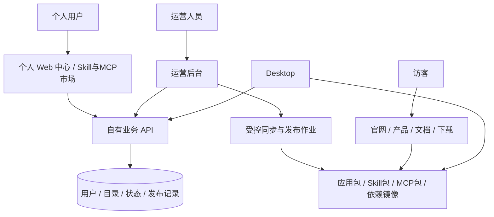

<!-- Copyright The Open Forge contributors. -->

# 第一阶段产品平台：个人账号、Web中心、Skill/MCP市场、官网文档与下载镜像

## 背景与目标

承接 [REQ-0029](../requirements/REQ-0029-product-backoffice-and-licensing.md)。用户最新明确：**不考虑支付；第一阶段交付个人登录注册与管理、个人 Web 管理端、Skill/MCP 市场、官网产品介绍与文档、应用下载和依赖下载镜像。**

r4 替换 r3 的首期范围：从企业授权/商务优先调整为个人产品公开使用闭环，Skill/MCP 市场与镜像提前进入第一期；合同、回款、企业席位/管控、私有化移到后续。两份 optimized/review 参考稿的有用边界继续保留，但其中支付/商务与企业首期建议不覆盖用户最新决定。

第一期成功路径：访客了解产品、读文档与下载安装包 → 个人注册登录 → Web 管理账号与设备 → Desktop 登录同一身份 → 发现 Skill/MCP 并完成安装/连接 → 缺少依赖时从可信镜像获得对应版本 → 管理员能处理用户、能力上架/撤回、版本和镜像故障。

当前只交付方案草案；不创建后台仓库、写运行时代码、注册域名、上传/镜像制品或部署。事实与历史调研见 [RESEARCH-0041](../research/RESEARCH-0041-product-backoffice-and-enterprise-control.md)。

## 当前事实与复用边界

| 已核实来源 | 事实 | 本期处理 |
|---|---|---|
| Desktop cloud/auth、feature-flags、cloud-slots | 登录界面、OAuth/refresh、用户/订阅查询客户端仍保留，默认构建不加载 | 复用界面与主进程 bridge，自有服务端新建，接入授权码/PKCE；不直接重开旧 token URL 登录 |
| `apps/docs-site/README.md` 与包配置 | 已有 Next.js/Fumadocs、中英文公开内容、搜索、SEO、LLM 发现入口与生产 HTTP 测试；不等于已部署 | 文档继续在本仓维护，官网引用同一公开文档，不再造副本或搬出内部 ADR |
| market schema/service/installers | 已有 skill/scene/plugin/mcp/bundle、目录快照与本地安装流程 | Skill/MCP 前台与运营后台共用目录，保留其他消费者的兼容类型 |
| `main/runtimes/manifest.json` | Node/Python、Windows MinGit 和 npm/pip 镜像配置；Python 源指向 GitHub | 接入产品依赖镜像时保留系统运行时选择、版本及既有回退语义 |
| runtime manager 与 vendor 预取脚本 | 已有逐源尝试、去重/重试入口；所读 Node/Python 下载路径未提供统一摘要校验合同 | 不能只改 URL 就宣称镜像可信；补固定版本、预期摘要、临时文件/原子落盘与安全解包 |
| 受管 fd/rg 目录与语音模型下载脚本 | 编码工具从 GitHub 发行物获取；语音模型已有大小/摘要清单 | 纳入镜像资产盘点；按启用功能与平台选取，不强迫下载全部资源 |
| 发布脚本、更新器、PLAN-0016 | 已有构建发布和更新链路及 stable/test 兼容 | 第一期提供基础批准版本/下载/更新一致性；大规模灰度与企业锁版后续 |

图谱 `.ua` 元数据仍为 2026-10-12，仅作导航；本轮回读上述当前源码，未刷新图谱或连接运行中的产品。独立服务端尚未建立，上游业务后台不在本仓；新建服务端仍建议独立私有仓库 `openforge-serv`。

## 第一阶段范围

| 产品面 | 本期必须交付 | 边界 |
|---|---|---|
| 个人账号 | 注册、验证、登录、退出、恢复、资料修改、会话/设备管理、账号停用/注销流程 | 建议邮箱起步；不做会员购买、支付/订单/发票，不自动上传本地项目 |
| 个人 Web 中心 | 总览、资料、安全、设备、我的 Skill、我的 MCP、收藏、安装/连接记录 | 云端用户资料与设备上报状态分开；不把移除记录伪装成卸载本地软件 |
| Skill 市场 | 分类/搜索、详情、作者/来源、版本、兼容性、工具需求、收藏、安装/更新入口 | 首期官方/受邀发布者供给；个人开放上传、付费与排名系统后续另议 |
| MCP 市场 | 本地/远程分类、详情、平台与运行依赖、连接参数说明、安装/连接/验证状态 | 平台不代运营所有 MCP 服务，第三方凭据留设备，连接仍需用户授权 |
| 官网 | 产品介绍、功能、系统要求、下载、更新日志、帮助入口、市场入口 | 只宣传已实现且可用的平台与功能；不编造案例和价格 |
| 公开文档 | 快速开始、账号、依赖安装、Skill/MCP使用、权限与故障恢复 | 复用本仓文档站，双语与既有 URL/发现规则保持一致 |
| 下载中心 | 明确平台/架构的当前批准版、历史版、版本说明、摘要/签名与安装帮助 | 不对没验证的操作系统提供“已支持”承诺，不随意自动选择架构 |
| 依赖镜像 | 产品实际需要的固定二进制与受控依赖包、来源/许可证、摘要、重试/回退 | 不做全量 npm/PyPI/GitHub 通用镜像，不提供任意 URL 转发 |
| 产品运营后台 | 用户/权限、发布者/市场、应用版本、镜像资产/同步、基础配置与审计 | 支持以上流程运营；移除首期销售/合同/回款/开票/企业席位菜单 |

## 入口与部署结构

建议官网、市场与个人中心共用主站，形成连续体验；运营后台有独立入口和管理员会话；文档站继续独立维护。产品版本文件、市场包和依赖包由对象存储/CDN 分发。

| 示例入口（待域名确定） | 职责 |
|---|---|
| 主站 `/`、`/product`、`/download`、`/updates` | 产品说明、下载与更新日志 |
| 主站 `/market/skills`、`/market/mcp` | 公共市场列表与详情 |
| 主站 `/account/*` | 个人 Web 中心 |
| 文档独立 origin | 保留当前文档无语言前缀路径与内容/搜索规则 |
| 管理端独立 origin 或受隔离 `/admin` | 运营管理；独立 API 权限，管理员 MFA |
| API `/api/v1/*` | 身份、用户资源、目录、安装请求、版本/镜像元数据 |
| 下载与镜像 origin 或资源命名空间 | 静态制品/CDN；与账号 API 的 Cookie、缓存策略分离 |

这些是入口设计，不要求七个服务或七个域名。先用 TypeScript 模块化业务单体、React Web、PostgreSQL 与持久化作业；大文件走 S3 兼容存储/CDN。API/作业同版本可分进程运行，初期不为多租户微服务、MCP托管集群或全量镜像平台增加基础设施。

公开官网、文档、安装包与公开依赖镜像原则上无需登录。市场允许匿名浏览；收藏、云端个人记录与账号绑定的安装请求需要登录。保留既有本地导入/公开资源安装路径，不把云服务强加为 lite 本地使用条件。

## 个人账号与 Web 管理中心

### 注册登录与账号安全

建议第一期邮箱注册/验证及密码或成熟组件支持的邮箱登录；选定方式后覆盖重发、过期、重复注册、找回、换邮箱、退出与撤销会话。采用成熟可自托管身份组件/库，先验证其恢复、MFA、PKCE和导出合同，不自造加密认证协议。

Desktop 通过系统浏览器登录同一身份，使用一次性授权码 + PKCE 与 state，回调不传播长期 token；既有 refresh 单飞、轮换、明确拒绝与临时故障语义保留。Web会话与Desktop凭据分别安全保存，管理员会话独立且要求MFA。

运营后台可查询用户、调整必要的功能访问、停用账号和撤销会话；不能代看密码、默认访问用户本地项目或伪造用户登录。账号停用阻止后续受保护云请求，不意味着远程删除本地数据。注销明确列出云数据处理、会话撤销与恢复/保留规则，不承诺抹掉不可控的本地副本。

### 个人中心页面

| 页面 | 首期能力 |
|---|---|
| 总览 | 账号状态、已关联设备、收藏与最近安装记录；不放账单/付费会员 |
| 资料 | 昵称、头像、验证邮箱与修改入口 |
| 安全 | 修改/恢复登录方式、查看和撤销会话、注销账号 |
| 设备 | 查看用户关联的客户端、版本、lastSeen，解除关联/撤销该设备会话 |
| 我的 Skill | 收藏、按设备安装记录、版本与更新提示、在客户端打开 |
| 我的 MCP | 收藏、按设备的安装/连接摘要、状态时间、在客户端配置/诊断 |

Web记录只包含实际可同步的资源id、版本、设备及结果摘要；MCP token、数据库密码、本地目录和工具参数默认不上传。明确显示“设备上次报告/离线/未知”；Web解绑设备不是擦除设备，“删除云记录”不是卸载，“已收藏”不是已安装。

第一期不提供网页远程控制任意离线Desktop、不自动同步全部Skill文件/本地会话、不替用户在后台启动MCP。

## Skill/MCP 市场与安装闭环

### 共用目录，分类型体验

市场共用发布者、唯一资源身份、分类/标签、详情、版本、兼容范围、来源、摘要与撤回状态。Skill说明用途/前提/工具需求；MCP说明本地/远程、平台、运行时、服务地址与需要用户填写的凭据。保留现有 scene/plugin/bundle 协议兼容，但第一期主要运营 Skill 与 MCP。

首期由官方/受邀发布者提交，运营审核上架。状态为草稿 → 校验/审核 → 批准指定版本 → 发布；弃用、停止新安装、安全撤回分别处理。版本字节不可覆盖，新增能力/权限/外部地址重新审查；服务端渲染的Markdown/图片和归档也属于不可信内容。

Web 和 Desktop 消费同一批准目录，可先导出现有客户端兼容快照并增加能力版本适配。现有 Schema v3 的插件制品字段不能直接当成所有 Skill/MCP 已具备的固定版本合同；逐类型扩展与保留旧源/安装身份，不能另造一套重复市场。

### 两条个人操作路径

- Desktop市场：搜索/详情 → 用户确认 → 缺少依赖时下载验证 → 安装/配置 → 加载/连接验证 → 回报可选的账号关联安装摘要。
- Web市场：搜索/收藏 → 点击“在应用中打开” → Desktop识别资源与指定版本 → 客户端显示详情/确认并完成同一安装流程；未安装应用时转下载和安装指引。

Web到Desktop只传递可校验的资源标识或短期单次请求标识；客户端重新取得批准目录/授权，不能在深链里接受任意shell命令、可执行URL、第三方secret或“免确认”指令。

本地MCP必须解决已锁依赖和运行时，远程MCP必须完成实际第三方授权与连接检查；市场上架/账号登录不等于已经连接第三方业务系统。[MCP Registry定位](https://modelcontextprotocol.io/registry/about)可作上游发现参考，产品自己负责目录审核与安装体验，不将其当二进制托管或安全保证。

卸载/断开、重装、更新失败恢复和撤回后阻止新安装都要有入口。云端安装记录用请求id/设备id/资源版本去重；重复打开网页安装链接不能产生多次并发安装。

## 官网、文档与应用下载

官网覆盖产品定位、真实能力、支持平台、入门路径、市场、下载和更新日志。个人中心登录入口与Desktop一致；文档复用 `apps/docs-site`，正文仍由 `content/docs` 管理，运营后台只管理必要的官网介绍/公告/导航，第一期不自建通用CMS或复制一套文档编辑器。

下载中心关联固定版本、commit、平台/架构、文件大小、摘要/平台签名、系统要求、发布时间与发布说明。推荐版、历史版和未支持平台有明确状态。基本运营流为登记可信CI制品 → 校验 → 运营批准 → 下载页/更新feed引用同一发布记录；复杂自动灰度后续增加。

下载不要求注册，不通过业务API转发整个安装包。可变的“推荐版”指针与不可变版本文件分开缓存；被撤回版本不会继续显示为推荐。保留现有更新器协议与生产发布门；准备好网站/后台不等于已获实际发布授权。

## 依赖下载镜像

### 镜像范围与优先级

| 第一批资产 | 原因与处理 |
|---|---|
| Node、Python固定运行时 | 已有Desktop清单/安装链路；按当前支持平台/架构纳管 |
| 精选MCP固定运行包及依赖闭包 | 只镜像顶层tgz并不能解决全部npm/pip依赖；按锁定依赖构建、检查与实测对应平台包 |
| fd/ripgrep、Windows可选MinGit | 产品实际使用的受管工具，尊重系统工具优先和用户选择 |
| 已启用功能需要的语音等资源 | 盘点实际许可与资产清单后按需纳入，不默认下载全部模型 |
| 构建期Electron等二进制 | 若影响本产品发布再列独立构建源；不把开发机器所有依赖都变成运行时下载 |

首期不建立完整npm/PyPI索引、不代理任意GitHub或用户输入URL、不托管用户自备模型。现有公共包镜像配置可作补充，但不能把外部公共镜像称为自己完整可运营的镜像站。

### 管理与发布合同

每个镜像资产至少含 assetId、类型、固定版本、平台/架构、原始来源、上游校验依据、许可证/归属、大小、SHA-256、镜像对象键、适用客户端范围及状态。受控作业按白名单来源拉取到隔离区 → 验证来源/完整性与再分发条件 → 扫描/归档校验 → 发布固定对象 → 发布经批准清单。管理员不能提交任意URL让服务器充当下载代理。

客户端使用内置或可验证的期望摘要；从同一可改服务器同时获得包和摘要不能单独证明来源。优先复用受信发布清单/签名及密钥更新合同，不新增任意远端配置执行能力。安装器在校验成功前不解包/执行，解包限制路径、文件数/体积及链接目标。

同版本对象不可覆盖；HTTP断点下载需验证Range/Content-Range、ETag或对象身份，恢复后仍校验整个文件。缓存命中也需验证，失败损坏文件不能成为“已安装”；下载至临时文件，校验后原子落盘。对象存储校验和与HTTP Range支持只是基础能力，必须在选定S3兼容实现/CDN上实际验证。[S3完整性说明](https://docs.aws.amazon.com/AmazonS3/latest/userguide/checking-object-integrity.html)、[GetObject](https://docs.aws.amazon.com/AmazonS3/latest/API/API_GetObject.html)

来源优先建议为本产品批准镜像 → 允许的备用镜像/原始来源；每个源提供相同固定字节且仍按相同摘要验证，禁止失败后改拉latest或其他架构。网络故障允许有限重试与用户重试；摘要异常隔离该制品/源并告警，不静默忽略继续安装。范围/超时/取消语义在客户端明确。

公开依赖原则上匿名下载，配限流、流量/容量预算和异常告警；不将账号token附加到公共CDN URL或在跨域重定向泄露。后台能看到同步状态、失败原因、批准版本、可用性、撤回与受影响产品范围。必须保留仍被受支持客户端引用的旧依赖，不能只存latest。

## 运营后台与核心数据

第一期菜单：用户与访问权限、官方/受邀发布者、Skill/MCP目录与审核、应用版本、镜像资产/同步、公告与下载导航、管理角色、审计与基础配置。

数据域为：User/Identity/Session/Device；功能访问Grant；Publisher/Capability/CapabilityRelease；Favorite；InstallRequest/DeviceObservation；ProductRelease/Artifact；DependencyAsset/MirrorJob/ManifestRevision；AdminRole/AuditEvent。身份提供方、业务用户、发布者和管理员角色分别映射，不把任意注册用户自动升级为发布者。

不建支付、账单、订单、回款、发票或渠道分成表作为第一期前置。保留公共模型扩展企业归属的可能即可，不提前实现企业组织/部门引擎。审计/个人记录尽量少存敏感数据，用户数据隔离和后台最小权限由API执行，不能只靠隐藏菜单。

## 实施顺序与第一期验收

下面是同一第一阶段内部的切片顺序，不表示把市场或镜像再次推迟到第二阶段。

| 切片 | 范围 | 完成证据 |
|---|---|---|
| A：平台与账号 | 固定身份/资源/版本合同，管理员保护，注册验证/恢复，个人Web资料与会话；新服务端最小骨架 | 用户可真实注册登录/恢复；后台分权；跨用户数据拒绝；Desktop PKCE正常/拒绝/重复回调验证 |
| B：官方资产供给 | 基础运营后台、精选Skill/MCP、应用批准版本、对应依赖清单/镜像 | 管理员能发布固定目录与文件；错误摘要/平台/许可不进入批准范围；旧版本保留 |
| C：个人使用 | Web/客户端共用市场、收藏/安装请求、设备记录、本地MCP安装及远程MCP连接 | 用户从发现到确认/安装/连接完成，秘密留设备；重复请求幂等；离线状态如实展示 |
| D：公开入口 | 官网产品介绍、复用文档、下载中心、文档中的账号/市场/依赖恢复指引 | 访客无需登录即可了解/读文档/下载；各入口引用真实批准资产，双语/搜索与链接检查通过 |
| E：联合验收 | 全链路正常与故障流程、升级/撤回、下载恢复、邮件投递/通知与运营处理、运维恢复 | 干净测试环境从下载到首次Skill/MCP成功；镜像主源故障/篡改/取消、会话撤销及资源撤回可正确处理 |

API与共享合同、镜像信任和安装生命周期串行确定后，Web、内容、Desktop适配可条件并行；实际编码才建立相应Task/Worktree。本轮串行规划，不建实施Task、不启动长驻dev、UI验证或真实用户实例。

### 必须覆盖的连续流程

1. 匿名访客读产品/文档，选择真实支持平台下载安装，注册并在Web和Desktop登录同一身份。
2. 收藏一个Skill，在应用确认安装；依赖缺失时只下载对应批准包，安装后能实际调用，Web展示来源设备和报告时间。
3. 本地MCP依赖安装/配置/连接成功；远程MCP完成用户授权且不把凭据同步到个人中心。
4. 镜像断线、断点恢复、摘要不符、磁盘不足、取消/重试、无支持架构都有可读结果；摘要错误不执行，重试不留假成功。
5. 找回/换邮箱、撤销某设备会话、停用/注销账号按合同处理；其他用户不能枚举或修改该账号资源。
6. 管理员批准/撤回能力或应用版本，Web/客户端/下载清单一致；既有安装如何提示与处置明确，不伪称远程瞬间卸载。

## 迁移、回滚与后续阶段

先复用现有目录和客户端公开入口，新增账号功能通过版本化API；旧源id、安装身份、lite模式、系统工具优先、取消/usage/错误等既有协议不被重写。Node/Python等镜像接入需要补可信校验与临时文件恢复，不仅替换URL。

文档保留本仓当前事实源和URL/双语规则；官网与个人中心不能擅自搬动文档或公开内部记录。用户账号和目录数据有备份/恢复验证，镜像可重新同步但不可抹掉来源/审核与已发布摘要证据。

后续阶段为企业组织与席位/策略/SSO、插件开放发布与开发者中心、私有化/离线许可/指定信创组合。支付、合同/财务与渠道业务本轮不考虑，只有用户另行提出时再立项；不作为待清空的第一期门禁。

## 风险、参数与ADR

关键风险：邮件投递/防滥用、恶意市场内容与归档、镜像供应链、下载流量/容量、个人状态过期与秘密泄露、客户端旧协议迁移。对应验收与预算要在实施Task中具体化；不为低成本假定所有依赖都可再分发，也不承诺所有平台立即可用。

待细化的是具体域名/地区、注册组件和邮件供应商、首批发布者与Skill/MCP清单、首批平台架构、镜像容量/流量、个人记录保留与上报选择。当前默认官方/受邀供给、邮箱账号、按已验证平台交付；这些是方案建议，不是已购买或已上线事实。

实现时按真实取舍记录ADR：独立个人平台与公开客户端边界、身份/PKCE与会话迁移、市场版本/安装身份、依赖镜像信任与回退、公开下载与账号API隔离、云端设备观察和隐私边界。没有选择就不提前写成已生效决策。
