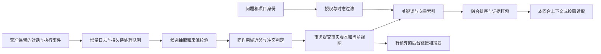

<!-- Copyright The Open Forge contributors. -->

# Agent 项目记忆与全局记忆调研

## 问题与范围

为 Open Forge 后续升级持久记忆提供证据：每个项目能延续决策和经验，Agent 也能保留跨项目的用户偏好与通用经验，同时避免项目串扰、过期事实和错误记忆累积。本轮是调研，未授权或实施运行逻辑变更、外部服务接入、模型评测或数据迁移。

外部资料核对日期为 **2026-10-22**。主要机制论文注明版本；LongMemEval 补充分析固定为 [v2](https://arxiv.org/html/2410.10813v2)，无版本链接仅作入口。开源实现核对当前默认分支的公开文件，未将其视为论文实验时的实现快照。架构推荐是工程判断，不是论文直接证明的 Open Forge 收益。本文只新增 Research 管理记录及导航，不递归建立文档维护 Task，也不创建或执行记忆功能的实施 Task。

## 当前结论

2026-10-22 续研补充：现有记忆的原因记录为 Hermes 启发、IM 专用的 [ADR-0009](../../docs/adr/0009-im-gateway-memory-rollover-and-dated-worklog.md)，不是 Pi 内置长期记忆的继承。当前 [IM host](../../apps/im-gateway/cmd/im-gateway/host.go) 传 memory flag，而 [Desktop 正常配置](../../apps/desktop/src/main/conversations/resolve-session-config.ts) 没有显式传 memoryMode；不能把 factory/Profile 的存在等同默认开启。此外当前 Desktop 的 [node:sqlite shim](../../apps/desktop/src/main/shims/node-sqlite.ts) 不可用，SQLite 要先过实际驱动/ABI门禁。具体候选方案进入 [PLAN-0021](../plans/PLAN-0021-agent-persistent-memory.md)，Pi 生态交叉验证另见 [RESEARCH-0039](RESEARCH-0039-pi-memory-implementation-benchmarks.md)。

**首选扩展本仓现有记忆模块：以本地结构化存储承载有作用域、有来源、有时间版本的事实，采用关键词与向量混合检索，保留按需读取原文的路径。** 吸收 Mem0 的写入阶段、Graphiti 的双时态、A-MEM 的轻量链接，并重点对照 MemOS local 的实现；初期无需把完整图服务、Python 运行时或另一套 Agent 框架接入每次对话。该结论属于本研究的推荐，依据与升级条件见后文。

1. **优先补齐有来源、有作用域、可演化的记忆记录和混合检索，再决定是否引入完整图引擎。** Mem0、Graphiti、A-MEM 分别提供写入决策、时间事实、笔记链接的参照，但公开结果不能证明“有图就更准”；Mem0 论文的图变体在 multi-hop 子集反而下降，详见下表。[Mem0 原始实验](https://arxiv.org/html/2504.19413v1#S4)
2. **“保留原文 + 派生记忆”值得保留。** LongMemEval 发现压成独立事实会损失部分任务信息；Graphiti 也保留 episode 到派生事实的来源关系。由此推导：摘要、标签、向量和图都适合作为可重建索引，不能成为唯一证据。[LongMemEval §5.2](https://arxiv.org/html/2410.10813#S5.SS2)、[Graphiti 当前说明](https://github.com/getzep/graphiti#why-graphiti)
3. **“写入时更新”与“后台整理”可以并存。** 新事实可以快速进入日志与可检索状态，昂贵的冲突确认、链接演化、经验提炼异步执行；LangMem 明确提供 hot path 与 background 两种模式，Letta 当前也保留后台 dreaming。取消人工整理不等于必须取消后台维护。[LangMem 概念](https://langchain-ai.github.io/langmem/concepts/conceptual_guide/#writing-memories)、[Letta 当前记忆文档](https://docs.letta.com/agent-sdk/memory#dreaming)
4. **必须区分 2025 论文与 2026 产品。** Mem0 当前已转向 ADD-only 抽取；MemOS 已提供 Node.js/SQLite 本地插件；Letta 当前源码已迁至 `letta-code`；GraphRAG 当前进入维护模式。只按旧论文做选型会漏掉这些变化。[Mem0 当前研究页](https://mem0.ai/research)、[MemOS 当前 README](https://github.com/MemTensor/MemOS)、[Letta 源码迁移说明](https://github.com/letta-ai/letta#historical-source)、[GraphRAG 当前 README](https://github.com/microsoft/graphrag)

## 事实来源与论文机制对照

| 来源与本文使用的版本 | 核心机制 | 对本项目的参考价值与边界 |
|---|---|---|
| [Mem0，2504.19413v1](https://arxiv.org/html/2504.19413v1)，2025-04-28 | 抽取候选事实，与近邻比对后 ADD / UPDATE / DELETE / NOOP；另有图变体 | 可参考候选→判定→持久化的明确写入阶段；不能照搬自动删除为无风险操作，也不能将图结构视为多跳收益保证 |
| [Zep，2501.13956v1](https://arxiv.org/html/2501.13956v1)，2025-01-20 | episode、实体/事实、community；有效时间与系统记录时间分离；矛盾边失效 | 最值得吸收的是双时态与 provenance；“过去住北京、现在住上海”分区间成立，不是在同一时刻都为真 |
| [A-MEM，2502.12110v11](https://arxiv.org/abs/2502.12110v11)，2025-10-08 | 结构化笔记包含上下文、关键词和标签；新增笔记会建链并触发旧笔记属性演化 | 可参考轻量关联与经验整理；演化结果应保留版本与证据，防止模型反复改写后偏离原始事实 |
| [MemOS，2507.03724v4](https://arxiv.org/html/2507.03724v4)，2025-12-03 | MemCube 封装内容和元数据，统一明文、激活、参数记忆的调度与生命周期 | 借鉴可迁移记录、版本和治理即可；调用外部模型的客户端通常无法自行掌控模型 KV/参数层，不必追求完整 OS 愿景 |
| [GraphRAG，2404.16130v2](https://arxiv.org/html/2404.16130v2)，2025-02-19 | 实体关系建图、分层社区检测、预生成 community summaries、查询时聚合 | 适合语料整体主题与趋势问题；索引与摘要有成本，不能把它等同于低延迟对话记忆 |
| [LightRAG，2410.05779v3](https://arxiv.org/html/2410.05779v3)，2025-04-28 | 实体/关系索引，低层具体知识与高层主题检索，增量合并图 | 可参考实体与主题两类召回信号；它并非简单把向量 top-k 多跑几轮，仍要实体关系抽取和索引维护 |
| [HippoRAG 2，2502.14802v2](https://arxiv.org/html/2502.14802v2)，2025-06-19 | phrase/passages 联合图，embedding 选种子、LLM recognition 过滤，PPR 排 passage | 适合跨文档关联检索；论文标题实际为 *From RAG to Memory: Non-Parametric Continual Learning for Large Language Models*，不是一套通用用户记忆 CRUD 服务 |
| [LongMemEval，2410.10813](https://arxiv.org/html/2410.10813)，[作者评测仓库](https://github.com/xiaowu0162/LongMemEval) | 500 个问题，覆盖抽取、多会话、更新、时态、应当拒答；S 约 115k tokens，M 约 500 sessions | 可作为公开对话评测，但编码项目记忆还必须补项目隔离、分支变化、错误工具经验等本地任务 |

### 用户引用的数字：能确认什么

以下均为对应作者报告，本次没有运行独立复现。差值由公开表格重算；百分比与百分点分别标注。

| 说法 | 原始数据与正确边界 |
|---|---|
| Mem0 相对 OpenAI +26% | Overall J **52.90→66.88**，约 **+26.43% 相对 / +13.98 个百分点**；“OpenAI”是作者构造的 ChatGPT memory 基线，不是所有 OpenAI 模型/当前产品的统一效果 |
| Mem0 图变体再 +2% | Overall J **66.88→68.44**，约 **+2.33% 相对 / +1.56 个百分点**；同表 full-context 为 **72.90**，所以“超过所有基线”过于笼统 |
| 图记忆专攻 multi-hop | 该论文 multi-hop J **51.15→47.19**；本实验不能支持图变体更强的断言 |
| p95 降 91%、token 降 90%+ | 总响应 p95 **17.117s→1.440s**，约降 **91.59%**；检索上下文 **26,031→1,764 tokens**，约降 **93.22%**，不能当作整个生命周期总账单节省 |
| Zep DMR 94.8% vs 93.4% | 是 **+1.4 个百分点 / 约+1.50%相对**；不是 LongMemEval 的 MemGPT 对照结果 |
| Zep LongMemEval 最高 +18.5% | `LongMemEval_s` 的 GPT-4o full-context **60.2%→71.2%**，即 **+11.0 个百分点**；表格四舍五入值重算约 **+18.27%相对**，正文称18.5% |
| Zep 延迟降 90% | 同一 GPT-4o 对照 **28.9s→2.58s**，约降 **91.07%**；不可与 Mem0 的 p95 指标横向排列成排名 |

Mem0 数字和基线定义见[论文 §3.2–3.3、表1–2](https://arxiv.org/html/2504.19413v1#S3)；Zep 数字见[论文 §4、表1–3](https://arxiv.org/html/2501.13956v1#S4)。两者的数据、模型、时点、评价器、候选数量及延迟统计口径不同；论文 QA 分数也不直接等于 Agent 完成工程任务的成功率。Mem0 的 token 口径主要是查询时提供给回答模型的检索内容，未给出可直接搬用的总拥有成本结论。

### 2026 当前 Mem0 已改变了写入策略

官方当前研究页采用 **single-pass ADD-only**、semantic/keyword/entity 多信号检索、temporal reasoning 和 soft memory decay；衰减描述为排序降权而非自动删除。当前 OSS 的 `Memory._add_to_vector_store` 也能看到单次抽取、`ADDITIVE_EXTRACTION_PROMPT` 和既有近邻输入。应将此与 2025 年四操作论文分开比较。[当前研究页](https://mem0.ai/research)、[当前 Python 写入源码](https://github.com/mem0ai/mem0/blob/main/mem0/memory/main.py)

当前 README 中 LoCoMo 92.5、LongMemEval 94.4 等新分数明确来自**托管平台**，包含 OSS SDK 没有的专有优化；不能用它们为自行集成 OSS 兜底，也不能与旧论文分数直接计算算法净增益。[Mem0 README 的 New Memory Algorithm 与评测限制](https://github.com/mem0ai/mem0#new-memory-algorithm-april-2026)

## 当前开源实现、运行代价与可借鉴部分

| 项目 | 已核实的代码与许可证范围 | 对本地 Coding Agent 的取舍（工程判断） |
|---|---|---|
| Mem0 | 当前仓库含 Python 与 TS；[root Apache-2.0](https://github.com/mem0ai/mem0/blob/main/LICENSE)；[配置](https://github.com/mem0ai/mem0/blob/main/mem0/configs/base.py)分别注入 LLM、embedder、vector store、history DB | 适合参考小型记忆 API 与作用域过滤；选定语言实现后还需核对功能对齐，不能默认 TS 与 Python/Cloud 完全等价 |
| Graphiti | [Apache-2.0](https://github.com/getzep/graphiti/blob/main/LICENSE)；当前[安装要求](https://github.com/getzep/graphiti#installation)列 Python、图数据库及模型/embedding；[边模型](https://github.com/getzep/graphiti/blob/main/graphiti_core/edges.py)含 `valid_at/invalid_at/created_at/expired_at` | 时态、来源、混合召回是优先参考；直接接入要额外承担图服务和 Python 边界。Zep 当前托管服务使用专有引擎，Graphiti OSS 不是它的整套可替换部署 |
| A-MEM | 论文分别链接[评测仓库](https://github.com/agiresearch/A-mem)与[记忆系统仓库](https://github.com/WujiangXu/A-mem-sys)；两者 LICENSE 均为 MIT | 笔记对象、邻居链接和演化策略可拆取；研究原型指标不代表完成本地并发、删除和恢复合同 |
| MemOS 服务 | [root Apache-2.0](https://github.com/MemTensor/MemOS/blob/main/LICENSE)；当前[自托管说明](https://github.com/MemTensor/MemOS#-self-host-the-memos-service)使用 API + Neo4j + Qdrant | 统一资源治理可借鉴；完整服务对本地客户端增加运维和迁移成本 |
| MemOS local plugin | [源码入口](https://github.com/MemTensor/MemOS/tree/main/apps/memos-local-plugin)；[package](https://github.com/MemTensor/MemOS/blob/main/apps/memos-local-plugin/package.json)当前为 `2.0.16-beta.1`、Node≥20、`better-sqlite3`、`@huggingface/transformers`，其中 license 字段为 MIT | TS + SQLite/FTS5/vector 是直接参照；root Apache 与子包 MIT 字段范围需进一步确认后才能复制/分发，不视为已完成许可证审计 |
| GraphRAG | [MIT](https://github.com/microsoft/graphrag/blob/main/LICENSE)；[当前 README](https://github.com/microsoft/graphrag)明确 mostly maintenance，索引可能昂贵 | 留作知识库整体摘要的可选路径，初期不作为所有对话必须经过的记忆核心 |
| LightRAG | [MIT](https://github.com/HKUDS/LightRAG/blob/main/LICENSE)；[当前说明](https://github.com/HKUDS/LightRAG#selecting-backend-storage)有 KV、vector、graph、doc-status 四类存储，可合并使用同一受支持后端 | 适合独立知识库侧车与双层检索参考；引入前需测文档更新/删除重建成本 |
| HippoRAG 2 | [MIT、Python 安装与当前实现](https://github.com/OSU-NLP-Group/HippoRAG)；论文 PPR 使用 `python-igraph` | 作为多跳漏召回时的实验候选；不是项目隔离、时态覆盖或遗忘政策的现成替代 |
| LangMem | [MIT](https://github.com/langchain-ai/langmem/blob/main/LICENSE)；核心变换不依赖特定 DB，高层持久化集成 LangGraph Store | namespace、结构化输出、前台/后台双模式更有借鉴价值；无需为少量写入逻辑迁移整个运行时 |
| Letta | [当前 Apache-2.0 的 letta-code](https://github.com/letta-ai/letta-code)；[旧仓迁移说明](https://github.com/letta-ai/letta)明确旧 V1 server 在 archive 分支 | 可借鉴 Agent 身份和记忆仓库独立于会话的设计；不是只在现有模型请求前加一个向量查询 |

这里的运行代价来自可见依赖与架构，不是本机实测。许可证仅记录主仓或指定文件，未完成依赖树、模型权重、数据集、NOTICE 或再分发审计。

### MemOS 的轻量形态与“本地”的边界

当前 local plugin 设计为 L1 trace、L2 policy、L3 world model 与 Skill，并有 OpenClaw、Hermes、DSH adapter，不能再仅凭 OS 论文判断它“只适合企业”。这是值得进一步读源码的轻量参照，但 beta 版本、原生 SQLite 绑定与模型加载仍是集成成本。[local plugin README](https://github.com/MemTensor/MemOS/blob/main/apps/memos-local-plugin/README.md)、[package.json](https://github.com/MemTensor/MemOS/blob/main/apps/memos-local-plugin/package.json)

**本地落盘不等于所有推理均在本地。** DSH adapter 默认复用已配置 Provider 做辅助 LLM 调用；缺少 Provider 时 trace 仍能工作，反思和演化降级。因此必须分别核对存储位置、embedding 位置、抽取模型与遥测，而不能从 local-first 名称推出无外发或零 API 费用。[local plugin 的 Provider 行为与降级说明](https://github.com/MemTensor/MemOS/blob/main/apps/memos-local-plugin/README.md)

### 补充项目：LangMem 与 Letta

LangMem 将语义事实、episodic experience、procedural instructions 分开，并提供层级 namespace、元数据过滤与语义检索。工程上最可取的是把作用域作为读写过滤条件，不要先全局召回再只靠 prompt 要求模型忽略别的项目。后一句是本研究的安全设计推导。[LangMem 官方概念](https://langchain-ai.github.io/langmem/concepts/conceptual_guide/)

Letta 当前的 MemFS 将记忆版本化：`system/` 每轮进入上下文，其他文件按目录树需要读取，shared repositories 可供多 Agent 共用；另有 dreaming 提炼近期经验。它说明“整个 Agent 有记忆”可以是持续身份和受控记忆空间，而非所有会话共用一份无限文本。其托管共享仓库与自托管 Git 方式有不同部署边界。[Letta 当前 Memory 文档](https://docs.letta.com/agent-sdk/memory)、[当前实现](https://github.com/letta-ai/letta-code)

## 图检索为什么有帮助，以及它没有保证什么

HippoRAG 2 的检索先找到与问题相关的 triples/passages，过滤候选，再把它们设为随机游走的种子。PPR 迭代可以理解为 `p_next = α·seed + (1−α)·Pᵀ·p`：一部分概率回到问题种子，一部分沿图关系扩散，最终按 passage 概率排序，将原文交给 LLM 作答。这是根据论文机制给出的概念解释，不是复刻其具体超参数。[HippoRAG 2 §3、附录G](https://arxiv.org/html/2502.14802v2#S3)

例如问题提到模块 A，而答案在“依赖 A 的 B 所采用的决策 C”中；共享实体与关系能把词面不相似的 C 带入候选。**它保证的是按图结构传播相关性，不是理解整个项目。** 缺边、误链接、热门节点和错误种子仍会影响结果；需要全局主题时，可补项目概要/社区摘要，但仍须回溯证据。GraphRAG 针对语料全局问题的设计与这种按问题传播的检索目标不同。[HippoRAG 2 方法](https://arxiv.org/html/2502.14802v2)、[GraphRAG 方法](https://arxiv.org/html/2404.16130v2#S3)

## Open Forge 当前源码事实与缺口

### 调查基线与调用链

本仓核对基线为 `1853699c924e7b26b285cd2901ebcd4757df0c80` 及本轮工作区；未读取用户的 MEMORY、历史会话或真实状态目录。已有 `.ua` 图谱分析于 2026-10-12，commit 为 `254796d870036f0d3e7c0bbb9a0a1a2cbd28448f`，共 17,009 节点与 35,740 条边。图谱落后于 HEAD，已核对相关一跳依赖与 Git 增量并回读源码；目标增量包含 prompt 相关文件，不能仅凭旧图判断注入行为。

当前链路为：宿主 `createMemoryRolloverRuntime` → Session 装配检查 `memoryMode` → 创建 Store / Flush / Journal → 注册 `memory` 工具和提示快照 → 自动压缩前抽取、按需 flush、完成回合记录 Journal。下表是静态源码/测试合同证据，不是本轮实机验证结果。

| 能力 | 当前事实与一手锚点 | 升级含义 |
|---|---|---|
| 启用条件 | [`peripheral-assembly.ts:294`](../../packages/coding-agent/src/composition/session-initialization/peripheral-assembly.ts) 取决于 `sessionOptions.memoryMode`；[Profile](../../packages/coding-agent/src/profiles/agent-profiles.ts) 的 `memoryEnabled: true` 是声明 | 有 factory 或 Profile 字段不能证明所有 Desktop / CLI / IM 入口均启用；先核对正常创建、恢复接线 |
| 默认落点 | [Desktop composition](../../apps/desktop/src/main/agent-runtime/composition.ts)、[Node SDK host](../../packages/coding-agent/src/host/sdk-session/node-session-host.ts) 默认 `<cwd>/MEMORY.md`、`<cwd>/JOURNAL.md`，支持显式 memoryFile | 主要是 cwd 级笔记；这条链路未见全局/项目自动组合、Agent 隔离与稳定项目身份 |
| 记录与容量 | [`memory-document.ts:1`](../../packages/coding-agent/src/memory/memory-document.ts) 默认为 4,000 **字符**，条目是分隔符连接的字符串 | 不是 4,000 tokens；缺少稳定 ID、来源和有效时间。可保留为小摘要视图，不能只扩大上限 |
| 显式修改 | [`memory-tool.ts`](../../packages/coding-agent/src/memory/memory-tool.ts) 支持 add / replace / remove；document 只处理首个包含 match 的条目 | 已有部分 CRUD，但 substring 不能充当长期事实身份，修订尚无版本审计 |
| 自动写入 | [`memory-flush-service.ts:19`](../../packages/coding-agent/src/memory/memory-flush-service.ts) 抽取、双向 substring 去重后只 add；首个写入失败就停止，外层失败返回空数组 | 尚非语义合并和自动冲突裁决；失败与“无新事实”可能呈相同结果，需要旁路状态 |
| 抽取证据 | [`ai-memory-fact-extractor.ts:50`](../../packages/coding-agent/src/memory/ai-memory-fact-extractor.ts) 仅 user / assistant 文本，不含 tool result；按 `- ` 行解析 | 已标记历史输入不可信，但派生条目未保存来源角色/span；助手声称成功不能等同执行成功 |
| 触发时机 | [`memory-rollover-runtime.ts:83`](../../packages/coding-agent/src/memory/memory-rollover-runtime.ts) 与[自动压缩策略](../../packages/coding-agent/src/compaction/runtime/automatic-compaction-strategy.ts) 在自动压缩前 flush；完成回合只写 Journal | 不能认定普通短会话均自动形成长期事实；需要回合增量与持久待处理队列 |
| 注入方式 | [`memory-rollover-runtime.ts:40`](../../packages/coding-agent/src/memory/memory-rollover-runtime.ts) 构造时冻结全文；[提示说明](../../packages/coding-agent/src/model-context/memory-prompt.ts) 新编辑仅下一 Session 重入系统快照 | 目前是全文小摘要注入，未见按问题检索；工具会返回更新状态，不能说当前回合完全不可见 |
| Journal | [`memory-journal.ts`](../../packages/coding-agent/src/memory/memory-journal.ts) 回合摘要最多 200 字符，rollover 摘要最多 2,000 字符，附时间 | 有损观察日志，不是完整证据或双时态记录 |
| 并发 | [Store](../../packages/coding-agent/src/memory/memory-store.ts) 读后改写；[Node storage](../../packages/runtime-node/src/host/text-file-storage.ts) 固定 `.tmp` 再 rename | 单次替换不等于多会话事务/版本仲裁；属于静态风险，未做竞态复现，不当已复现 Bug |
| 相邻知识库 | [README](../../packages/runtime-knowledge/README.md)、[query](../../packages/runtime-knowledge/src/query/knowledge-query.ts)、[Node port](../../packages/runtime-node/src/host/knowledge-runtime.ts) 为 wiki/raw ingest、tag query 和 page write | 在所读 memory 和此 query port 中未发现向量记忆检索；不能把用户转述文章的“已向量化”当本仓事实，也不推断仓库其他功能没有向量能力 |

既有测试覆盖字符串操作、超限不变更、去重、失败 best-effort、冻结快照、memory mode 关闭和压缩续写，没有证明项目隔离、语义召回或长期任务收益。本轮只读测试，未运行行为测试。[Store](../../packages/coding-agent/test/memory/memory-store.test.ts)、[Flush](../../packages/coding-agent/test/memory/memory-flush-service.test.ts)、[Session 组合](../../packages/coding-agent/test/composition/memory-runtime.test.ts)、[压缩集成](../../packages/coding-agent/test/runtime-core/memory-context-runtime.test.ts)

依据 [Coding Agent 包规则](../../packages/coding-agent/AGENTS.md)，记什么、抽取时机、scope 晋升、冲突和预算属于产品策略；具体文件/SQLite/embedding Provider 由宿主经窄 Port 注入。新上下文来源优先走既有 [ContextProvider](../../packages/runtime-core/src/kernel/contracts.ts)，保持 Turn admission 固定 generation、取消、失败和释放语义。暂不决定新增包，也不为调研制造一套与 Knowledge、Conversation Repository 平行的框架。

## 建议的记忆模型与运行流程

本节是候选设计，**不是已存在的合同或实施授权**；假定保持本仓本地优先定位，跨设备同步与团队共享不作第一阶段前提。

### 作用域与长期身份

| 作用域 | 保存什么 | 默认边界 |
|---|---|---|
| 用户全局 | 明确、稳定的语言/编辑偏好和跨项目习惯 | 绑定用户身份；项目业务数据和指令不自动晋升 |
| 项目 | 架构决定、仓库约束、验证过的陷阱与原因 | 绑定稳定 projectId，仅在当前授权范围内共享 |
| 任务 / 分支 | 尝试方案、未完成事项、临时假设 | 绑定 taskId / 分支视图；验收后才考虑晋升 |

`agentId` 和团队/成员权限是正交维度：多个 Agent 可以受控共享用户偏好，私有 Agent 经验不因此向全部成员开放。`sessionId` 标记来源，不是长期身份。存储可统一，但授权过滤必须发生在查询/图遍历时，不能全局召回后只靠 Prompt 遮挡。

projectId 不应仅等于目录：同仓库 Worktree 可能共享项目事实，但分支状态不同；同名项目、不同 SSH authority、目录迁移和 monorepo 子项目也有不同映射。建议宿主项目注册表提供稳定 ID 和显式关联，Git 元数据辅助识别；不能仅因 remote URL 相同自动共享私有记忆。

### 事实、双时态和非线性历史

建议记录覆盖五类信息，字段名与最终 Schema 留给后续设计：

- **身份/范围**：稳定 memoryId / revision、用户/项目/Agent 可见性、任务/分支视图、事实类型。
- **内容/证据**：完整命题、来源 session/turn/message/span 或文档版本、source role、证据等级与确认状态；source_ref 受权限和保留周期约束，不能只有日后失效的路径。
- **时间**：`valid_from/valid_to` 表示何时成立，`recorded_at` 与修订历史表示何时得知/纠正；未知有效时间不填造。
- **生命周期**：active / superseded / contested / retracted、替代/矛盾关联、pin 与禁止保留策略。
- **派生版本**：embedding、摘要和图链接标记模型/版本，可重建，不作为唯一事实源。

例：10 月 22 日才得知“项目 A 自 10 月 15 日切换数据库”，有效时间是 15 日，记录时间是 22 日；应分别回答“18 日实际用什么”和“18 日当时我们知道什么”。这是对 Graphiti 双时态的应用推导；可以先用关系表保存，不要求图数据库。

按天记录只解决日期组织；**并行分支是不同情境，不能仅按时间先后合并**。分支 X 试 PostgreSQL、Y 仍用 SQLite，不互相撤销；“计划迁移”和“完成迁移”也不是同一谓词。只有同 scope、对象、单值关系与适用区间内的可靠矛盾才进入替代判断；证据不足保留 contested，不让 LLM 猜测覆盖明确事实。

### 写入时演化，证据和事实版本追加

从 Mem0 四操作中吸收“明确判定”，不等于让模型任意改库：ADD 追加新事实；UPDATE 追加修订并调整当前投影；NOOP 保持幂等；模型提出的 DELETE 默认是撤销/失效候选。**用户明确遗忘另走实际清除链路**。这样兼顾 ADD-only 的追溯性与 UPDATE 的当前查询，不抹掉有用历史。

正常回合结束后只捕获新增证据，以 source span + extractor version 形成幂等键；先持久化待处理任务，再异步抽取、重试和重放，不每轮扫描全部历史。修订提交需要版本检查/事务；embedding 失败时事实仍可经关键词检索，索引可恢复。显式“记住/纠正/忘记”给出清晰反馈；自动失败不改变主回合终态，但必须可观察，不能永远伪装成“无新事实”。

原始证据优先引用既有 ConversationDocument/事件和获准保留的文档版本，避免另一套无限原文。成功经验需成功 tool result / 测试结果等证据，助手总结只作线索；失败经验附适用版本和条件，不变成无条件禁令。后台演化记录输入版本，更新派生笔记而不抹掉出处。

### 检索与注入

1. 宿主固定本 Turn 的用户、项目、Agent 授权与分支/时间；先限制查询范围，再分别召回全局允许条目与项目/任务条目。
2. 先具备 ID/路径精确查询与关键词召回，再加 embedding，以 RRF 等可解释方式融合。中文改写、标识符、错误码、路径分别评测；相似度不是事实可信度。
3. 候选执行状态/有效时间检查、同源去重与重排。默认取当前事实，历史问法切有效区间；时间新不能自动压过可靠证据。
4. 注入少量事实、成立条件、时间和出处，细节按需读原文。“保留原文”不等于全文无预算拼进每次请求。
5. 小型稳定核心摘要配合检索增量。外部版本在下一 Turn admission 生效，本 Turn 工具写入/读取可经有来源的结果可见；不为“实时记忆”破坏 generation 一致性或每次重写系统前缀。

SQLite 是初期候选，可承载结构化记录/事务，FTS5 提供全文索引和 BM25；向量实现仍需验证 Electron/Node/Bun、Windows 打包、模型大小与中文效果。FTS5 tokenizer 也要用本仓语料验证，不能假定启用即有合适中文切词。[SQLite FTS5](https://www.sqlite.org/fts5.html)

WAL 允许读与写并行，但仍只有一个写者，且不能按同样方式跨主机使用网络文件系统；宿主需管理连接、事务、重试和生命周期。跨设备/远程项目同步另立合同，不直接共享本地 DB 文件。[SQLite WAL](https://www.sqlite.org/wal.html)

项目概要、实体别名、有证据的 1–2 跳链接可后加。多跳漏召回成为实测瓶颈才试 PPR；整体主题问法确有需求才试社区摘要。全局概要与具体事实可以用不同策略，不要求一个算法包办。

### 遗忘和控制面

区分排序降权、过时/纠正失效、隐私清除：前者不改事实，第二类保留历史，第三类覆盖请求范围内的事实、原文副本/引用目标、向量、关系、摘要、缓存和导出，并明确备份实际保留边界。需要防重抽取措施，如不存明文内容的来源撤销标记与 scope 禁止保留策略；不能只删向量后又从旧会话重建。

低频访问不等于无用，pin 和稳定约束不应只按访问次数衰减；高频检索也不证明正确，避免错误被不断强化。用户可查看“记了什么/为什么/来源/适用项目”，并纠正、删除、禁记、导出；控制面不意味着每条记忆都要弹窗审批。

记忆不能升级为工具权限或覆盖当前用户指令和仓库规则。MINJA 在受测条件中展示了仅靠查询交互污染记忆、无需直接写库的攻击；因此保存 source trust，把网页/工具/模型内容作为证据数据，禁止自动晋升高权限指令。这些措施不是已证明的完整防御，仍需回归。[MINJA，2503.03704v5](https://arxiv.org/abs/2503.03704v5)

## 后续实施路线与选择条件

| 候选 | 优点 | 当前代价与建议 |
|---|---|---|
| 扩展本仓 Store / Flush / ContextProvider | 保留宿主、工具、协议和生命周期，能逐片交付 | 自己完成 scope、事务、评测与删除；**当前首选** |
| MemOS local | TS + SQLite，已有 adapter、捕获与混合检索参照 | runtime 适配、beta/原生模块、模型与许可范围待审计；先源码/隔离原型，不默认复制安装 |
| Graphiti 侧车 | 现成时态图与实体检索 | Python/图服务和跨进程故障成本；实测图查询/规模瓶颈时考虑 |
| Mem0 / LangMem / Letta 整体框架 | 写入 API、namespace、持续 Agent 身份各有价值 | 语言/Cloud-OSS 差异或运行时重叠；先取机制，无需整体迁移 Agent |

以下为研究建议，没有时间承诺或预建实施任务：

| 阶段 | 可独立验证的产物 | 继续条件 |
|---|---|---|
| P0：启用路径与基线 | 正常 Desktop/CLI/IM 创建、重开、切项目时的工具/注入状态；脱敏合成历史和无记忆对照 | 知道哪里启用、何时写、模型看到什么，不把 factory 存在当功能交付 |
| P1：scope 与版本存储 | 全局/项目/任务隔离，ID、来源、事务、显式记住/纠正/删除和重启恢复 | 不串项目，修订可追溯，删除不复活，旧格式兼容 |
| P2：自动捕获和混合检索 | 持久队列、增量抽取、关键词+向量、预算注入、失败重放与查看入口 | 同预算改善跨会话任务，写入/查询成本和延迟可接受 |
| P3：双时态和经验演化 | 迟到更正、分支视图、晋升、软衰减、摘要/链接版本 | 历史/当前问法分别正确，程序性经验减少重复失败 |
| P4：有证据再引图 | 多跳试关系表/PPR，全局问法试概要层 | 相对 P2/P3 的消融有稳定净收益，覆盖额外维护成本 |

P1 必须为 P3 留足来源和时间信息，可推迟复杂推理，不能先丢证据再后补。动态属性的可靠替代也不能等 P3，否则 P2 会持续召回过时状态。

迁移先导入 `MEMORY.md` 并标 legacy 来源，不虚构有效时间；Journal 只作有损辅助。新旧读写/工具合同版本化收敛，避免文件与 DB 长期双写成为两个事实源，不静默覆写用户手工文件。旧文件保留回滚路径；schema/embedding 版本分开，索引重建不改事实。默认新落点建议宿主用户状态目录，避免每个项目根长出私人记忆待提交文件；显式导出/共享另行选择。

## 评测：找回事实与完成任务分别衡量

LongMemEval 能检验抽取、多会话、更新、时态与拒答，不能单独证明编码体验。补充一手证据如下，本轮未复现，也不算 Open Forge 成绩。

| 研究 | 本轮核实范围与结论 |
|---|---|
| [MemoryArena，2602.16313v2](https://arxiv.org/abs/2602.16313v2)，2026-09 | 多会话 Memory-Agent-Environment 任务覆盖规划、搜索、导航和推理；作者发现对话记忆榜单与其 agentic 任务表现有差距，提示测“记忆指导后续行动” |
| [Evo-Memory，2511.20857v2](https://arxiv.org/abs/2511.20857v2)，2026-05 | 将经验复用放进顺序任务流，研究检索、适应与演化；提示测连续任务收益和错误传播，而非仅离线建库后问答 |
| [VibeMemBench，2609.23570v1](https://arxiv.org/html/2609.23570v1)，2026-09 | 111 个编码目标、90 个仓库；作者所测 12 组 system/solver 配对中 11 组未超过匹配无记忆基线。样本经过“参考设置中经验注入有益”筛选，不能外推所有 Agent 的失败率；借鉴固定 Agent/工具/预算并用可执行测试判收益的设计 |

先用合成、脱敏的本仓连续流程建基线，再补公开 benchmark：

| 连续用户流程 | 观察结果 |
|---|---|
| A 项目告知约定，重启后新会话继续 | 正确使用并能溯源，不需重述 |
| B 项目同名模块使用相反约定 | 不取 A 的私有事实，全局偏好按合法规则适用 |
| 偏好变更，旧新会话共存 | 当前用新值，历史问法说明旧值区间 |
| 迟到更正、否定、多值事实和未来计划 | 不按最后一句机械覆盖，不把计划当完成 |
| 两个 Worktree 并行试验 | 共享确认项目事实，分支假设隔离 |
| 删除后恢复旧会话并重建索引 | 不从摘要、向量或重抽取恢复被删内容 |
| 助手说成功，真实工具失败/取消 | 不写成“已验证成功” |
| 写入退出、索引失败、并发更正 | 不丢已提交事实，幂等恢复，冲突有确定结果或待确认状态 |
| 当前源码与旧记忆冲突 | 可验证源码优先，旧经验标适用版本 |
| 路径/错误码、中文改写、多跳决定追溯 | 分别量化关键词、向量、混合、图的效果并回到原文 |
| 无关记忆或网页包含行为指令 | 不提升权限、不覆盖指令，不确定时拒答 |
| 连续类似修复并接受反馈 | 后续少走已验证失败路径，可执行成功率提升 |

对照至少包含当前小摘要、无记忆、关键词、纯向量、混合，必要时加图；固定模型/Prompt/语料版本、写入/查询预算与候选数量，报告重复运行变动。检索层记录 Evidence Recall@k、有效证据比例、当前/历史正确率、误合并/污染和拒答；任务层记录可执行成功率、重复失败、步骤和用户纠正。成本拆开抽取/embedding/重排/回答 token、索引与后台处理、冷热 p50/p95、DB/向量大小，不只报回答省 token。

隔离、未授权外发和删除恢复是正确性门槛；有限集合须零已知违规，但零失败不是对所有输入的绝对保证。性能阈值根据 P0 基线与用户预算决定，本文不虚构 SLA。真实 Provider 或用户历史评测需另行授权。

## 被否决的方案

以下是面向 Open Forge 的工程判断，不表示对应项目无效。

| 暂不采用的选择 | 理由与替代方向 |
|---|---|
| 直接按论文冠军排名选完整框架 | 基准、版本、模型、评价器和服务形态不同；先建立当前系统、BM25/向量、混合检索的相同预算对照 |
| 仅保留模型整理后的“事实” | 抽取遗漏和错误合并可能不可恢复；保留允许保留的原始证据引用，派生索引可重建；删除请求必须覆盖这些副本 |
| 冲突即物理删除 | 时态变化、用户纠正、不同项目/分支和模型猜测不是同一种冲突；优先失效、替代关系或待确认状态；隐私删除另走实际清除链路 |
| 全局记忆存储等于跨项目自动共享 | 存储可统一，但检索/写入 scope 必须明确；项目事实向全局晋升应有独立条件 |
| 统一按最近访问衰减并永久删除 | 冷门但重要的约束会被误忘；衰减先作用于排序，固定规则与显式 pin 另行处理；用户要求删除不能仅降权 |
| 所有写入同步执行完整图演化 | 会将失败、费用与尾延迟带到用户响应；采用可重放日志、可检索提交和受预算约束的异步派生 |
| 完全取消后台整理 | 新笔记可即时写入，但全局去重、索引恢复、模型升级重建和经验抽象仍有后台价值；应减少人工维护，而非承诺完全免维护 |

## 代码 / 测试 / 指标锚点

外部源码的重点阅读入口：

- Mem0：`mem0/memory/main.py` 的 `_add_to_vector_store`；`mem0/configs/base.py` 的 Provider / storage 配置。[源码](https://github.com/mem0ai/mem0/blob/main/mem0/memory/main.py)
- Graphiti：`graphiti_core/edges.py` 的 `EntityEdge` 时间字段与 episode 引用。[源码](https://github.com/getzep/graphiti/blob/main/graphiti_core/edges.py)
- A-MEM：论文的 evaluation 与 memory-system 链接是不同仓库；复现必须固定所用分支/版本。[论文链接说明](https://arxiv.org/abs/2502.12110v11)
- MemOS local：`apps/memos-local-plugin/core/`、`agent-contract/`、`adapters/`，以及 `core/storage/migrations/`；从 adapter 进入点核查同一 turn 的 recall/save、失败与取消行为。[目录](https://github.com/MemTensor/MemOS/tree/main/apps/memos-local-plugin)
- LongMemEval：`src/evaluation/evaluate_qa.py`、`longmemeval_s/m/oracle`；本次只读取说明，未下载/执行模型评测。[评测仓库](https://github.com/xiaowu0162/LongMemEval)

本轮核实了论文、官方文档与公开源码；未安装上述库、未调用真实 Provider、未使用用户运行中的 Agent 或真实状态目录，也没有测得 Open Forge 的准确率、延迟或成本收益。

### 本轮文档验证（2026-10-22）

- 只读 Node 脚本检查本文及研究索引：61 个相对文件链接全部存在，LF、frontmatter 必填值、必要章节和代码围栏检查通过；没有把本地路径校验当作外链可用性或行为测试。
- `bun run test:impact -- project/research/RESEARCH-0038-agent-persistent-memory.md project/research/README.md`：退出 0，明确报告无受影响可测试代码并跳过，**不代表记忆行为测试已运行**。
- `node scripts/quality/check-project-indexes.mjs`：通过；`git diff --check -- project/research/README.md`：通过。新增未跟踪正文另经上述实际文件读取检查，未仅依赖 Git diff。
- 纯 Research 管理记录，无运行时变化；未运行完整 `bun run check`、构建、UI/真实模型评测，也未迁移任何数据或执行发布。未改动其他现有代码及研究条目。

## 失效条件与置信度

- **高置信度**：指定论文表格、公开源码可见字段、当前 README 明示的部署形态和指定 LICENSE 内容。
- **中置信度**：机制对本仓的预期价值；尚无同预算本地 benchmark、长期并发/恢复测试支撑。
- **未验证**：厂商当期完整平台实现、当前宣传分数的独立复现、每套依赖的最终再分发条件、本机内存/打包成本。
- 默认分支、托管产品和文档可变；后续进入选型/实现时必须重新固定 commit、核对许可证和依赖，不能用本文日期替代版本锁定。
- 数据规模、embedding/LLM、scope、工作流或用户对跨项目共享的预期发生变化时，应重做对应结论。

## 下一步触发信号

进入实施前按 P0 确认入口与基线，再为获授权的首个纵向切片建立 REQ / Task；候选先过隔离、来源、更新/删除、恢复与费用边界，再测召回和任务成功。多跳漏召回或全局概括不足有明确基线证据时才引图。本记录不构成实施、收费服务接入或用户数据迁移授权。
