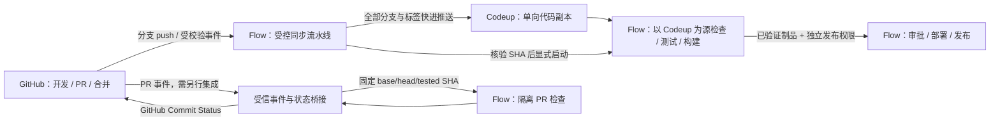

<!-- Copyright The Open Forge contributors. -->

# GitHub 单向同步 Codeup 与 Flow 承载 CI/CD 调研

## 问题与范围

**可行：继续在 GitHub 开发、提 PR 和合并，以 GitHub 为唯一写入源；单向同步到 Codeup，由 Flow 执行检查、测试、构建和部署。合并后的自动化可以做到零 GitHub Actions；保留 GitHub 合并前的必需检查，需要另外打通 PR 事件和结果回写。** 这是基于公开接口的设计结论，尚未在用户的云效组织完整执行该 CI/CD 链路，不等于现成的一键镜像功能；两个指定代码库的只读连接和推送演练结果见 2.1、2.2 节。

**2026-10-26 用户澄清：同步全部分支和记录，不限 `dev` / `main`。** 本方案因此以 GitHub 的全部 `refs/heads/*`、全部 `refs/tags/*` 及其可达完整提交历史为同步范围；用户随后将当前目标指定为 [Codeup ALLSTAR-AI](https://codeup.aliyun.com/621301e6c5006adb19febbd6/Allstar_AI/ALLSTAR-AI)，此前 AI_Plat 的验证保留为历史记录。提交对象保持原样，包含作者、时间、消息、父提交和 merge commit；GitHub 的 PR/Issue/评审/评论、Release 附件、Actions 日志及平台权限并不因此迁移。云效通用迁移明确列出代码、分支、提交、标签，网页导入明确不含合并请求和成员权限。[通用三方迁移](https://help.aliyun.com/zh/yunxiao/user-guide/common-tripartite-code-platform-migration)、[网页导入范围](https://help.aliyun.com/zh/yunxiao/user-guide/import-the-three-party-code-base-through-the-web-page)

**随后用户已执行首次手动同步，Agent 核对两端全部 24 个分支、1 个标签的名称与 SHA 一致。持续自动同步和 CI 迁移尚未验收完成；GitHub 的 11 个自定义 Actions 工作流仍启用，可访问的现有 Flow 配置未关联本目标。** 证据和权限边界见 2.3 节；不能继续把 2.1、2.2 节的空库演练状态当成当前状态。

**如果“创建的云效仓库”是普通新建空库，不能直接套用 Codeup 原生“仓库同步”。** 官方仅承诺网页导入库及指定 GitLab 迁移库具有该入口；既有普通库可通过受控 Git 推送接收代码，无需删除重建。[Codeup 仓库同步](https://help.aliyun.com/zh/yunxiao/user-guide/warehouse-synchronization/)

本研究关联 [ISSUE-0029](../issues/ISSUE-0029-ci-actions-budget-exhausted.md)，提供证据、候选架构、成本条件与后续验收要求，并在用户指定目标库后追加连接、推送演练和手动同步后的只读审计。Agent 未实际推送代码、创建云效资源、安装 GitHub App、修改工作流、触发远程构建或发布；首次实际同步由用户执行。实施、付费和发布仍需其明确范围。

## 事实来源

- 调查日：2026-10-26，Asia/Taipei；本地源码基线 `main@fb4e7b780388b8ebf90819d06d37dfb6aa105769`，Desktop 当前开发版本 `0.1.3`。
- `.ua` 图谱为 2026-10-12 历史导航，当前包括 `quality.yml` 在内的六个工作流文件相对图谱基线已有变化；本轮行为以当前 `.github/workflows/`、仓库脚本与 manifest 为准。未刷新图谱。
- 阿里云与 GitHub 的公开文档可能继续更新；下文将“官方已文档化”“工程建议”“需目标实例验证”分开，不把搜索不到某功能当作永久不支持。
- 本地 CI 事实由 Coordinator 检查，外部能力由后台 research 调查；结论写入本单一研究正文，索引与内部发布说明由 Coordinator 收尾。

### 第一方证据索引

| 标识 | 资料 | 支持的范围 |
|---|---|---|
| A1 | [仓库同步](https://help.aliyun.com/zh/yunxiao/user-guide/warehouse-synchronization/) | 原生同步来源限制、强制覆盖、管理员权限与同步禁写 |
| A2 | [TriggerRepositoryMirrorSync](https://help.aliyun.com/zh/yunxiao/developer-reference/api-devops-2021-06-25-triggerrepositorymirrorsync/) | 导入库可通过 API 请求远程同步；返回触发结果 |
| A3 | [代码源触发](https://help.aliyun.com/zh/yunxiao/user-guide/code-source-trigger) | GitHub push 与 Codeup push/tag/MR 事件的支持区别 |
| A4 | [流水线源 sources](https://help.aliyun.com/zh/yunxiao/user-guide/pipeline-sources) | GitHub 代码源、签名 Secret、完整历史与流水线间触发 |
| A5 | [服务连接管理](https://help.aliyun.com/zh/yunxiao/user-guide/service-connection-management) | Region 的 GitHub App 授权连接；不构成 PR 检查集成承诺 |
| A6 | [CreatePipelineRun](https://help.aliyun.com/zh/yunxiao/developer-reference/createpipelinerun) | 中心/Region 新 OpenAPI 启动流水线、运行变量及分支/tag 参数 |
| A7 | [Webhook 触发流水线](https://help.aliyun.com/zh/yunxiao/user-guide/webhook-trigger-pipeline-1/) | 通用 Webhook 与变量；执行者身份继承 |
| A8 | [环境变量](https://help.aliyun.com/zh/yunxiao/user-guide/environment-variables/) | 获取代码后的 `CI_COMMIT_SHA`；多源下标与适用边界 |
| A9 | [构建集群](https://help.aliyun.com/zh/yunxiao/user-guide/build-a-cluster/) | 托管 Linux、私有 Linux/Windows/macOS、架构、计费及 Region 差异 |
| A10 | [计费说明：中心版本](https://help.aliyun.com/zh/yunxiao/product-overview/billing-description/) | 基础/高级、免费核分、并发和高级功能 |
| A11 | [计费说明：Region 版本](https://help.aliyun.com/zh/yunxiao/product-overview/billing-description-region-version) | 按量开通、账号共享额度、个人/企业许可证 |
| A12 | [按量计费规则](https://help.aliyun.com/zh/yunxiao/product-overview/pay-as-you-go) | 核分公式、超额单价、存储与计量边界 |
| A13 | [LFS 迁移指南](https://help.aliyun.com/zh/yunxiao/user-guide/lfs-migration-guide) | LFS 对象必须独立拉取/推送，Git refs 不等于大文件实体 |
| A14 | [定时触发流水线](https://help.aliyun.com/zh/yunxiao/user-guide/timing-trigger-pipeline/) | 周期调度；仅 Codeup 可按代码有无变化决定是否启动 |
| A15 | [触发流水线与并发度](https://help.aliyun.com/zh/yunxiao/user-guide/trigger-pipeline-operation-2/) | 单流水线实例限流及生产串行部署 |
| A16 | [服务连接](https://help.aliyun.com/zh/yunxiao/user-guide/service-connection) | 外部服务凭据与成员使用范围 |
| G1 | [Commit statuses API](https://docs.github.com/en/rest/commits/statuses) | 外部 CI 按 SHA/context 回写状态，无需运行 Actions |
| G2 | [排查 required status checks](https://docs.github.com/en/pull-requests/how-tos/merge-and-close-pull-requests/troubleshooting-required-status-checks) | 最新提交、test merge 与同名检查的合并条件 |
| G3 | [Protected branches](https://docs.github.com/en/repositories/configuring-branches-and-merges-in-your-repository/managing-protected-branches/about-protected-branches) | 外部状态成为合并门禁、strict 与来源绑定 |
| G4 | [Webhook 校验](https://docs.github.com/en/webhooks/using-webhooks/validating-webhook-deliveries)、[最佳实践](https://docs.github.com/en/webhooks/using-webhooks/best-practices-for-using-webhooks)、[失败交付](https://docs.github.com/en/webhooks/using-webhooks/handling-failed-webhook-deliveries) | 签名、HTTPS、交付去重、快速响应与补偿 |
| G5 | [GitHub Actions 计费](https://docs.github.com/en/billing/concepts/product-billing/github-actions) | public/private、标准/大型托管 runner、自托管费用边界 |
| G6 | [git-push](https://git-scm.com/docs/git-push) | refspec、快进与 `--mirror` 的强推/删除语义 |

## 当前结论

### 1. 推荐架构：Flow 负责同步，再从 Codeup 执行 CI/CD



路线可以不经过 Actions：GitHub 的 push Webhook 直接触发 Flow 的 GitHub 代码源；同步任务把全部来源分支和标签同步到 Codeup。构建、部署和发布另外按事件、分支、路径及授权筛选，不因同步全量历史就执行每个历史版本的任务；GitHub 标签事件仍需桥接或定时对账，不能假定原生提交触发完整覆盖。Flow 已文档化 GitHub push、Codeup 源及流水线间触发能力；“受控 Git 推送 + 精确 SHA 校验”是基于这些能力组合的工程建议。[A3](https://help.aliyun.com/zh/yunxiao/user-guide/code-source-trigger)、[A4](https://help.aliyun.com/zh/yunxiao/user-guide/pipeline-sources)

同步任务只执行受信控制脚本，不运行刚拉取代码的安装钩子、测试或任意命令。获取 GitHub 对象与向 Codeup 写入分离；真正检查、测试、构建在代码入 Codeup 且校验通过之后进行。这样既符合“单向入库后跑流水线”，也避免有写库凭据的同步节点执行外部 PR 代码。

对本仓保留现有分支职责：`origin/dev` 是开发集成候选，`origin/main` 是稳定分支；本地 `main` 不是 GitHub 稳定分支已经晋升的证据。Codeup 同名分支仅反映 GitHub 对应分支；同步不自动创建 PR、合并或晋升稳定版。生产环境和发布步骤需要其既有授权与人工控制。

### 2. 原生仓库同步能做什么，不能假定什么

| 项目 | 已核查结论 | 对方案的影响 |
|---|---|---|
| 一次导入与后续同步 | 网页导入后支持再次触发同步；普通新建库不在原生支持范围 | 已有空库采用受控 Git 推送；不为获得入口自动删除/重建 |
| 同步方向 | 从来源库覆盖 Codeup，不适合两边同时开发 | GitHub 唯一写入源，Codeup 限制人工写入 |
| 自动频率 | 文档说明手工“立即同步”和 API；未承诺内置周期、每次 GitHub push 自动同步或时延 SLA | 自动化需要 Flow/桥接/定时调度；不能承诺秒级镜像 |
| 覆盖与保护 | 原生同步会覆盖差异、绕过保护规则，同步期间禁止写入 | 不把原生强制同步作为默认长期任务 |
| 分支/tag/删除 | 原生说明不足以定义精确 ref 白名单、删除传播、重打 tag 或全部特殊 refs 的合同 | 以试验验证；推荐路线默认不传播删除、不覆盖重打 tag |
| LFS/子模块 | Git refs 同步本身不证明 LFS 实体或子模块远端可用 | 分别检查 LFS 对象与子模块地址/权限 |
| 下游事件 | 未取得“原生镜像同步完成必定产生 Flow 可消费 push”的保证 | 显式核验，再启动下游；防止重复自动触发 |

前五项源自官方已描述的入口及未覆盖范围，不推断更强能力。[A1](https://help.aliyun.com/zh/yunxiao/user-guide/warehouse-synchronization/) LFS 官方迁移流程要求另行下载、上传实体。[A13](https://help.aliyun.com/zh/yunxiao/user-guide/lfs-migration-guide)

`TriggerRepositoryMirrorSync` 可以请求同步，但响应只说明触发结果，不能据此判断 Codeup 已收到指定 SHA。若后续选择此路线，需等待并验证目标 ref/对象，在超时/失败时停止下游；API 套餐可用性、目标组织支持情况与调用限额仍需核实。[A2](https://help.aliyun.com/zh/yunxiao/developer-reference/api-devops-2021-06-25-triggerrepositorymirrorsync/)

按照用户澄清，同步范围为全部 `refs/heads/*` 和 `refs/tags/*`，包含 GitHub 上的 Task 分支；不默认混入 `refs/pull/*`、平台内部 refs、`refs/remotes/*` 或只存在于开发机器的本地分支。普通快进失败、来源历史改写、标签冲突时报警并停机；删除默认不传播，另行审查处理。`git push --mirror` 会强推全部 refs 并删除目标多余 refs，与本仓禁止自动 force push 的边界冲突，因此采用明确的分支/标签 refspec。[G6](https://git-scm.com/docs/git-push)

首次同步的建议命令如下，**这里只给出示例，本轮没有执行克隆或实际推送**；工作目录须为新建的专用目录，目标同名分支/标签存在时先比较历史。`--bare` 完整克隆把来源分支放入本地 heads，省略 `--depth` 保留完整历史；不能在日常开发工作区简单执行 `push --all`，那只选本地 heads，且会混入尚未进入 GitHub 的内容。[git-clone](https://git-scm.com/docs/git-clone)、[git-push](https://git-scm.com/docs/git-push)

```powershell
$syncDir = 'C:\Users\xquan\Desktop\open-forge-allstar-sync.git'
git -c http.version=HTTP/1.1 clone --bare https://github.com/hxquan-q/open-forge.git $syncDir
git -C $syncDir -c http.version=HTTP/1.1 push --dry-run --atomic https://codeup.aliyun.com/621301e6c5006adb19febbd6/Allstar_AI/ALLSTAR-AI.git 'refs/heads/*:refs/heads/*' 'refs/tags/*:refs/tags/*'
```

演练和发布触发隔离核对后，实际同步使用同一推送命令移除 `--dry-run`。后续 Flow 每轮重新获取全部 heads/tags；仍须比较来源快照与目标 SHA，校验源端 ref 集合一致。历史导入前先控制目标流水线的自动发布入口，防止旧 `v*` 标签入库触发发版。LFS 实体与子模块仍需独立核查。

### 2.1 指定 AI_Plat 的实际验证（2026-10-26）

| 检查 | 实际结果 |
|---|---|
| GitHub 源库远端 refs | `ls-remote --heads --tags origin` 成功，24 个分支、1 个标签 `v0.1.2` |
| Codeup 指定目标库 | `ls-remote` 成功，返回 0 个引用；仅表明当前凭据可见范围未列出分支/标签 |
| 完整 Git 对象可用性 | 遍历上述 25 个来源引用：5682 个去重可达提交、126828 个 Git 对象、缺失对象 0；当前本地库非浅克隆 |
| 全量推送演练 | 对上述 25 个精确对象/ref 映射执行 `push --dry-run --atomic --porcelain`，退出码 0，24 项 `[new branch]`、1 项 `[new tag]` |
| 演练后目标复查 | 再次 `ls-remote` 成功，仍返回 0 个引用，未创建目标分支/标签 |
| 本地与 GitHub 差异 | 本地 36 个分支、18 个标签；多出的本地内容和上游标签不自动成为 GitHub 来源范围 |

最初两端连接均在 TLS 阶段失败，指定单命令 `http.version=HTTP/1.1` 后本轮多次读取得到成功；未改全局 Git 配置或关闭证书验证，不据此断言已定位 TLS 根因。演练直接使用本地已有的精确对象，没有向 Codeup 发送提交对象或更新 ref。`--dry-run` 成功只证明本次推送规划及协商通过，尚未验证真实数据传输、服务端接收钩子/配额、分支保护、默认分支、LFS 或下游流水线行为；不能称全量同步已完成。

此处 5682 只统计 GitHub 当前 heads/tags 可达历史，不包括已删除且不可达的历史引用、GitHub 平台记录、仅本地未推送的提交，也不包含独立仓库的 LFS 二进制/子模块对象。实际写入后应重新读取两端全部 heads/tags 并逐项比较名称与对象 ID，而不是只检查文件树或最新一条 commit。

### 2.2 更换目标 ALLSTAR-AI 的实际验证（2026-10-26）

用户随后要求核对 `Allstar_AI/ALLSTAR-AI`，本轮仅将验证目标切换至该库，不写入 AI_Plat 或 ALLSTAR-AI，也不更改本地远端配置。

| 检查 | 实际结果 |
|---|---|
| 新目标读取 | `ALLSTAR-AI.git` 的 `ls-remote --symref` 退出码 0、返回 0 个引用 |
| 实时来源 | 重新读取 GitHub，而非使用本地缓存：24 个分支、1 个标签；其中 `chenxvhua` 已与 `dev` 指向相同提交，不能沿用此前的旧 SHA |
| 历史与对象 | 来源引用可达 5682 个去重提交、126828 个 Git 对象，缺失对象 0 |
| 原子推送演练 | 对新目标运行 `push --dry-run --atomic --porcelain`，退出码 0，24 项 `[new branch]` 与 1 项 `[new tag]` |
| 演练后核对 | 新目标仍返回 0 个引用；重新读取的 GitHub heads/tags 与演练快照一致，验证期间没有来源变化 |

本轮采用与 2.1 节相同的只读/演练边界：没有真实传输 Git 对象、创建远端引用或触发流水线。初步连接与协商通过不等于已经验证服务端接收钩子、配额或后续 Flow 行为。上方命令现指向 ALLSTAR-AI；正式推送前须核对其历史标签的发布触发隔离，之后再移除 `--dry-run`，真实写入后逐项比较来源与目标的全部 heads/tags。

### 2.3 首次手动同步与现有自动化状态审计（2026-10-26）

用户报告已完成同步后，Agent 多次重新读取两端 `ls-remote --heads --tags` 并逐行比较。GitHub 与 ALLSTAR-AI 各为 24 个分支、1 个标签，名称与对象 ID 全部一致。这确认了当前 Git 引用快照一致，不证明将来的提交会自动同步，也不覆盖 LFS 实体或 PR/Issue 等平台记录。

| 检查项 | 实际证据 | 结论 |
|---|---|---|
| GitHub Actions | `actions/permissions` 返回 `enabled: true`；11 个 `.github/workflows/` 自定义工作流全部 `active`，另有系统 Dependency Graph 工作流 | 现有 Actions 仍启用，尚未完成切换停用 |
| GitHub 仓库 Webhook | 仓库 Hooks API 返回 0 项 | 未见仓库级 Webhook 同步入口；不能据此排除 GitHub App、组织级或云效定时任务 |
| 仓库内同步实现 | 当前 11 个 workflow 中没有 Codeup/ALLSTAR-AI 同步配置；未发现 Flow 配置事实源 | 不能把克隆来的 Actions YAML 当作已创建的 Flow 流水线 |
| Codeup API | 用户终端查询成功，目标 ALLSTAR-AI 的仓库 ID 为 `7608911` | CLI 认证与该代码库查询可用 |
| Flow 列表 | 用户终端返回 3 条现有流水线 | 列表存在不等于已关联本项目，需核对详情 |
| 可访问的 Flow `5059259` | 只读摘要显示 `sources: []`；配置中未发现 ALLSTAR-AI、目标仓库 ID、GitHub 来源、`git push`、本仓质量检查/质量测试及调度关键字 | 没有本目标已接通自动同步/CI 的配置证据；关键字检查不替代完整运行验收 |
| 其余两条旧 Flow | 详情返回 `403 InvalidPipeline.NotHavePipelinePermission` | 停止重复查询，不请求扩大组织权限，也不改动这些流水线；其内部配置未知 |

官方 `GetPipeline` 返回代码源的仓库、分支、`isTrigger`、事件和流程配置；列表权限与单条流水线权限不能混同。[GetPipeline](https://help.aliyun.com/zh/yunxiao/developer-reference/getpipeline-get-pipeline-details)

用户令牌仅配置于其原 PowerShell 进程，Agent 进程及 User 环境中均未发现令牌。因此详情由用户终端调用 CLI，输出经过筛选的本地摘要供 Agent 阅读；未将 PAT、Webhook 地址、完整流程脚本或其他业务仓库清单存入本仓。首个长 JMESPath 表达式在复制过程中被破坏，改用安装目录外部的只读 PowerShell 查询助手后取得摘要；助手的本地自测验证了字段提取及敏感字段排除，不调用真实 API。

后续应以 ALLSTAR-AI 为目标建立专用的同步及 CI 流水线，验证新的 GitHub 提交能自动到达 Codeup 的同一 SHA，且 Flow 执行/回写符合门禁合同后，再停用对应 Actions。本轮未创建、修改或运行任何云效流水线，也未停用 GitHub Actions。现有公开 GitHub 仓库使用标准托管 runner 的运行分钟免费，不把历史预算故障直接当作当前账单结论。[GitHub 计费](https://docs.github.com/en/billing/concepts/product-billing/github-actions)

### 3. 合并后 CI/CD 与合并前 PR 门禁是两条链路

Flow 当前公开事件表和较新的 `sources` 文档均只为 GitHub 列出 push；Codeup 才列出 MR 新建/更新事件。文档中的 GitHub App 服务连接提供代码仓库授权、克隆及分支操作，不能由此推断它自动订阅 PR、覆盖 fork PR 或回写 Checks。**现查公开资料未承诺完整的原生 GitHub PR 检查集成**；如目标实例提供新能力，应以实际权限、事件与回写结果重新核验。[A3](https://help.aliyun.com/zh/yunxiao/user-guide/code-source-trigger)、[A4](https://help.aliyun.com/zh/yunxiao/user-guide/pipeline-sources)、[A5](https://help.aliyun.com/zh/yunxiao/user-guide/service-connection-management)

只监听主库 push 可以覆盖合并后的提交，也可为同库开发分支做检查；它不等价于 PR 检查：新开 PR 未必有新的 push，fork push 不会自动成为主库 push，PR 目标分支变化也不一定带来源分支 push。不能先移除旧 required checks，再期待合并后的 Flow 测试阻止坏代码合并。

保留完整门禁的建议是受信 GitHub App/Webhook 桥接：接收 PR 生命周期事件，对账 PR 的仓库、base SHA、head SHA、测试提交与权限；启动无发布密钥的 Flow PR 流水线。若要求所有测试输入也先进入 Codeup，由控制面将经过允许的 PR 快照存入专用不可发布命名空间或隔离仓库，不能让 fork 作者获得 Codeup 写权限。执行器只拿短期只读权限，状态回写由控制面完成。

外部 CI 可用 Commit Status API 回写 `pending/success/failure/error`，绑定实际提交 SHA、稳定 context（如 `yunxiao/quality`）及 Flow 详情 URL；这不依赖 Actions 执行器。可使用 GitHub App installation token 或受限 fine-grained PAT 的 `Commit statuses: write` 权限；普通 CI 克隆只读权限与状态写入凭据分开。[G1](https://docs.github.com/en/rest/commits/statuses)

门禁至少记录 `(baseSHA, headSHA, testedSHA, pipelineRunId)`。PR 更新后先把新 SHA 置 pending；旧 run 只能更新自身对应 SHA，取消/超时不能回写 success。以精确合并结果验证时，应按 GitHub 的 head/test merge 判断规则设计回写位置；base 前移后重新验证，不能只凭旧 head 的绿灯。切换 required contexts 要先观察新状态真实出现，再替换旧要求；避免同名 Check Run 与 Commit Status 叠加造成两个都必须通过。[G2](https://docs.github.com/en/pull-requests/how-tos/merge-and-close-pull-requests/troubleshooting-required-status-checks)

工程上还需维护 PR 的有效运行代次：同一个 head SHA 可能因 base 更新或重跑产生多个 run，不能仅按 head SHA 去重。回写前核对当前 base/head、有效 run 与代次，过期结果只归档；否则旧 run 的晚到 success 仍可能覆盖同一 head/context 的新 pending。同一提交同时参与多个 PR 时，优先回写各自合并结果 SHA 并验证 GitHub 实际采用该检查；只能用 head 状态时，必须设计上下文隔离与门禁聚合，不能直接共享同名绿灯。

GitHub 分支保护可以要求外部状态、开启 strict 并绑定预期 App 来源；私有仓库可用性依套餐。桥接须支持重试、重跑和结果查询，否则 Flow 已完成而回写失败会让 PR 永久 pending。[G3](https://docs.github.com/en/repositories/configuring-branches-and-merges-in-your-repository/managing-protected-branches/about-protected-branches)

### 4. 精确 SHA、去重和部署顺序

新版 `CreatePipelineRun` 已文档化中心/Region 接入点、`envs`、`runningBranchs`、`runningTags`；未见直接指定 commit SHA 的字段。本方案不把“选择 dev 分支”解释为“锁定某次事件 SHA”。建议传 `TARGET_SHA` 等受校验的运行变量，由下游从 Codeup 明确获取并检出该对象，**执行任何业务脚本前**核验实际 `HEAD == TARGET_SHA`。也可评估不可变 CI 快照 ref；它必须使用独立命名空间，不能误匹配 `v*` 发布触发。[A6](https://help.aliyun.com/zh/yunxiao/developer-reference/createpipelinerun)

不能仅设置 `TARGET_SHA` 然后照常跑分支最新代码。Flow 的 `CI_COMMIT_SHA` 来自获取代码步骤，多源时应使用带下标变量；脚本另行 checkout 后，需记录实际 Git HEAD，不能假定内置变量随之自动更新。[A8](https://help.aliyun.com/zh/yunxiao/user-guide/environment-variables/)

同步与生产部署分别限制并发。Flow 支持单条流水线实例并发限制，生产可设为 1；串行本身仍不能证明旧事件不晚到，因此部署前还应检查“待部署制品 SHA 是否仍是该环境批准版本”，并记录制品摘要、版本、来源 run。发生快速连续提交、乱序 Webhook 或人工回滚时，策略必须明确，不能让晚完成旧任务覆盖新版本。[A15](https://help.aliyun.com/zh/yunxiao/user-guide/trigger-pipeline-operation-2/)

Webhook 使用 HTTPS、验证 HMAC、按 `X-GitHub-Delivery` 去重，并快速确认后排队处理。GitHub 不自动重投失败交付，需有失败补偿和周期 refs/PR 对账；不得假定传递恰好一次或顺序一致。[G4 校验](https://docs.github.com/en/webhooks/using-webhooks/validating-webhook-deliveries)、[G4 最佳实践](https://docs.github.com/en/webhooks/using-webhooks/best-practices-for-using-webhooks)、[G4 失败交付](https://docs.github.com/en/webhooks/using-webhooks/handling-failed-webhook-deliveries)

Flow 的 GitHub 源支持 `triggerSecret`；桥接使用其通用 Webhook 时，URL 是敏感触发凭据，且执行身份与最后启用者相关。优先受控 OpenAPI；运行时输入只传经校验的 SHA/ref/PR ID，不允许任意代码地址、命令或环境变量覆盖发布权限。[A4](https://help.aliyun.com/zh/yunxiao/user-guide/pipeline-sources)、[A7](https://help.aliyun.com/zh/yunxiao/user-guide/webhook-trigger-pipeline-1/)

### 5. 构建机与费用：节省 Actions 额度不等于全部免费

| 项目 | 官方能力或价格 | 方案含义 |
|---|---|---|
| 中心站基础版 | 免费、流水线 3000 核分/月、构建任务并发 3；Git/LFS 各 20 GiB，制品 10 GiB | 可先评估 Linux 检查；核分不能当作相同数量分钟 |
| 中心站高级版 | 618 元/人/年、5 人起；私有构建集群为高级专属 | 按最低年席位口径为 `618 × 5 = 3090 元/年`，另有机器和超额资源费用 |
| Region | 先开通按量；个人模式最多 5 个账号、无许可证费；企业 2 元/人/天；免费资源按阿里云账号跨组织共享 | 不能套用中心站的高级版售价；须核实所选模式的构建集群资格 |
| 托管集群 | 公共与 VPC 托管均列 Linux；Region 不提供公共集群 | Region 需要 VPC 托管或私有机；网络、NAT/EIP、可用地域另计 |
| 私有机 | 文档列 Linux amd64/arm64、Windows amd64、macOS amd64/arm64 | Windows/macOS 是接自己的机器，不是云效免费提供这些系统的托管 runner |

套餐与资源数据分别来自 [A10 中心站](https://help.aliyun.com/zh/yunxiao/product-overview/billing-description/)、[A11 Region](https://help.aliyun.com/zh/yunxiao/product-overview/billing-description-region-version)。OS、架构和 Region 差异来自 [A9 构建集群](https://help.aliyun.com/zh/yunxiao/user-guide/build-a-cluster/)；该页对 Region 私有机还使用 Linux 的具体说明，不能据总览断言目标 Region/模式一定已开放 Windows/macOS，须在选定实例验证。

本仓有 macOS ARM 与 Intel 两套发布/测试要求。全面迁移之前必须落实可用 Mac、Windows 与图形测试环境、Bun/Node、Electron 依赖、签名/公证和 Xcode 工具链；仅能调度 shell 命令不证明现有桌面 E2E 可运行。私有机要隔离不可信 PR 与签名发布，任务后清理并验证缓存/工作区隔离，不能把用户正在使用的机器直接作为试验环境。

公开按量规则是 `核分 = 实际构建分钟 × CPU 核数 × 集群系数`；超额构建资源中国站参考价 `0.03 元/核分`，私有集群构建不计该配额。公共系数 1、VPC 文档系数 0.8；排队与部署等待不计构建时长。示例：公共 4 核单任务 15 分钟为 60 核分，3000 核分相当于 50 次这种任务；100 次为 6000 核分，超额 3000 核分按该单价约 90 元。**这是算术示例，未测本仓耗时，不是月费承诺。**[A12](https://help.aliyun.com/zh/yunxiao/product-overview/pay-as-you-go)、[A9](https://help.aliyun.com/zh/yunxiao/user-guide/build-a-cluster/)

月总成本应计 `许可证 + 云效超额核分/存储 + 自有或租用机器 + 网络/制品存储 + 运维时间`。GitHub 标准托管 runner 在 public 仓库免费，private 仓库受套餐分钟与存储配额约束；大型 runner 另计费，自托管仍有自己的基础设施成本。当前未读取账户账单或验证仓库 visibility，不能仅因项目定位开源就量化节省金额。[G5](https://docs.github.com/en/billing/concepts/product-billing/github-actions)

## 代码/测试/指标锚点

### 现有自动化迁移清单

当前共有 11 个 workflow；迁移对象是其中的行为合同与仓库脚本，不能把 Actions YAML 原样交给 Flow 执行，也不能用删除测试来降低消耗。

| 当前入口 | 已存在行为 | 迁移要求 |
|---|---|---|
| [`quality.yml`](../../.github/workflows/quality.yml) | `dev` push/PR/manual 跑 `check`、`test:quality`、`verify:runtime-contract`、`verify:artifact:installed`；PR/manual 另跑 Linux/macOS/Windows `test:changed --base <baseSHA>` | 保留四项门禁、完整 Git 历史与明确 base SHA；合并后与 PR 策略分开 |
| [`pr-title.yml`](../../.github/workflows/pr-title.yml) | PR 标题约束 | 依赖 PR 元数据，迁到控制面或 Flow 小任务；不能指望 Git 镜像带出 PR 标题 |
| [`docs-site.yml`](../../.github/workflows/docs-site.yml) | check/test/build/`test:production` HTTP 连续流程 | 当前是检查，不能误写成已有 Vercel 部署；Flow 保留产物与 HTTP 验证 |
| [`mobile.yml`](../../.github/workflows/mobile.yml) | Linux typecheck/lint/export:web | 迁等价 Linux 任务；不自动扩大为 EAS 付费构建 |
| [`kotlin.yml`](../../.github/workflows/kotlin.yml) | Java 21、Android SDK、Gradle Host Test 与 assembleDebug | 专用环境镜像/私有机及 Gradle 缓存 |
| [`im-gateway.yml`](../../.github/workflows/im-gateway.yml) | Go vet/build/test 与 lint | 保留 Go 工具链及对应测试 |
| [`desktop-packaged.yml`](../../.github/workflows/desktop-packaged.yml) | 合同检查、Node tests、路径 scope 后三平台真实 packaged E2E | 保留 scope 决策、三平台图形/安装环境与失败证据 |
| [`desktop-macos-test.yml`](../../.github/workflows/desktop-macos-test.yml) | macOS 专项任务 | 私有 Mac 工具链和 runner 资格验证后迁移 |
| [`desktop-upgrade-e2e.yml`](../../.github/workflows/desktop-upgrade-e2e.yml) | 升级 E2E | 单列历史版本输入、下载/安装/更新链路，不被普通单测替代 |
| [`desktop-cache.yml`](../../.github/workflows/desktop-cache.yml) | 每周一/四，Linux/Windows/macOS ARM/Intel 四环境预热 | 原平台缓存不再被消费后应停用旧定时任务；只压缩 dev push 不会消除这部分消耗 |
| [`desktop-release.yml`](../../.github/workflows/desktop-release.yml) | `v*` tag/manual，prepare→quality→多平台构建/验证→发布与更新 feed；R2 正式渠道同时发布 GitHub Release，测试渠道隔离 | 保留双出口、所有架构、签名/公证、制品摘要/版本/来源、更新元数据与独立发布准入 |

关键源码位置：`quality.yml:35–44,83`；`docs-site.yml:53–62`；`desktop-cache.yml:17`；`desktop-packaged.yml:32–35,56–59`；`desktop-release.yml:266–285,473,606,669,732,756`。这些是调查基线的导航行号，后续实施以文件实际内容为准。

根 manifest 使用 `bun@1.3.14`。依赖安装由 [composite action](../../.github/actions/install-bun-dependencies/action.yml) 接 [install-ci-dependencies.mjs](../../scripts/quality/install-ci-dependencies.mjs)，下载缓存按 OS/arch/lock 等事实隔离。Flow 需重建缓存/产物传递规则并复用仓库命令；GitHub 的 `uses:` 步骤和缓存命中不会自动迁移。

平台适配的两个具体接缝：[`desktop-packaging-scope.mjs`](../../scripts/quality/desktop-packaging-scope.mjs) 优先使用 `DESKTOP_PACKAGING_BASE_REF`，否则依赖 `GITHUB_EVENT_*` 等上下文，并默认把结果写到 `GITHUB_OUTPUT`，迁移需显式传 base SHA 并映射输出；[`resolve-desktop-release-config.mjs`](../../scripts/release/resolve-desktop-release-config.mjs) 已有通用 `EVENT_NAME`/`REF_TYPE`/`INPUT_*`/`VAR_*` 输入，但工作流中的 `--github-output`、`GITHUB_ENV`、`GITHUB_STEP_SUMMARY` 仍需改接 Flow。依赖安装的 Node 主体可复用，其 frozen install 最多重试三次；日志注解格式并不表示只能在 Actions 执行。

发布合同还包括：正式 R2 渠道保留 R2 更新源与 GitHub 下载/说明两个出口；测试渠道不发正式 GitHub Release。GitHub 发布先以精确 SHA 建 draft，上传完整 assets 后再公开；已经发布的非 draft Release 拒绝改写。迁移不能将 GitHub/R2 误设为互斥二选一，不能缺凭据时静默切换发布目标，也不能把标签字符串存在当作 tag/SHA 一致的证据（`desktop-release.yml:666–725`）。

[`desktop-release-workflow.test.mjs`](../../scripts/quality/desktop-release-workflow.test.mjs)、[`ci-dependency-install.test.mjs`](../../scripts/quality/ci-dependency-install.test.mjs) 等质量测试读取当前 GitHub 配置。后续迁移必须同步更新其合同事实源，覆盖新 Flow 配置/脚本的同等约束；不能直接删 YAML、删断言或跳过质量脚本换取绿灯。

历史 [TASK-0321](../tasks/TASK-0321-ci-budget-trigger-slimming.md) 已在 2026-10-19 削减 `dev` push 矩阵及 packaged 触发。ISSUE-0029 仍记录预算问题，但本研究没有重新调用远端 CI，不能断言当前账户所有 workflow 仍因同一预算限制秒败。

### 候选方案比较

| 方案 | Actions 用量 | 优点 | 条件与判断 |
|---|---|---|---|
| **A：Flow GitHub 同步入口→Codeup→Flow CI/CD** | 可为零 | 满足既有 Codeup 库与入库后执行；不用另起持续运行同步服务 | 推荐合并后主线；同步脚本/权限/精确 SHA/下游显式触发需实施验证 |
| B：GitHub App/Webhook 桥接→Codeup 快照→Flow | 可为零 | 可统一 PR/fork/tag、去重、补偿、回写 | 需要维护受信控制面；推荐作为完整 PR 门禁与标签事件补充 |
| C：Flow 直接以 GitHub 为全部 CI 源，另做 Codeup 备份 | 可为零 | 步骤少，减少同步前置延迟 | 技术可行，但构建输入绕过“先同步到云效库”；仅用户放宽此目标时采用 |
| D：Codeup 原生导入同步 API→下游 | 可为零 | 导入来源库可复用平台同步 | 强制覆盖、普通新建库不适用；自动时延与完成事件待核，不作为默认 |
| E：Flow 定时拉 GitHub，再推 Codeup | 可为零 | 无需公开自建 Webhook 服务；可作漏事件补偿 | 有延迟与空轮询开销，不适合作为低延迟 PR 唯一门禁 |
| F：保留最小 Actions 仅同步/派发 | 很少 | 与现有事件整合容易 | 预算限制时轻量 job 也可能无法启动；不满足严格零依赖，可作过渡 |

Flow 支持周期调度；“代码未变化则不启动”文档仅适用于 Codeup 源，不能假定 GitHub 定时任务天然无空跑成本。[A14](https://help.aliyun.com/zh/yunxiao/user-guide/timing-trigger-pipeline/)

### 建议迁移顺序与最低验收

这是未来实施任务的顺序建议，不代表本轮已经获得改配、付费或发布授权。

1. **确认目标与账单口径。** 只读确认 GitHub visibility/保护规则、云效中心或 Region/组织模式、Codeup 创建来源、Git/LFS/子模块、现有内容及容量、runner 资格。列明预估核分、席位和机器费用，保留 GitHub 作为唯一写入源。不要为选型直接开通按量订单。
2. **先验证单向同步。** 用专用样本库完成首次导入、连续两个提交、重复/乱序事件、分支冲突、tag 冲突、删除、断网重试、LFS 和子模块；校验 GitHub 对象、Codeup 对象与目标 SHA 完全一致。同步失败不触发构建；不自动 force、不传播删除。
3. **迁 Linux 门禁并并行取证。** 保留 `check`、`test:quality`、runtime/installed artifact、受影响测试和各语言任务。初次影子期不发布；记录相同 SHA 在新旧环境的结果、耗时、制品摘要与环境版本。只有实际通过才能称迁移成功。
4. **接通 PR 门禁。** 覆盖同库/fork 新建与更新、reopen、关闭、base 前移、冲突、权限撤销、取消、超时、旧 run 晚返回、状态回写失败补偿及重跑。确认每个 PR 的最新适用 SHA 必须绿才能合并，再切换 GitHub required checks。
5. **落实多平台与发布。** 接入并隔离 Windows、macOS ARM/Intel；验证 packaged/upgrade E2E、签名公证、GitHub/R2 与 feed 全链路。Flow 可运行命令不等于有现成 GitHub Release 插件；发布可复用仓库脚本/CLI/API，由独立受信节点持凭据。未经样本与授权不跑真实发布。
6. **验收后停旧任务。** 新门禁、tag/manual 发布和补偿路径均确认后，再禁用对应 Actions；检查 schedule、workflow_dispatch、标签与缓存预热入口，避免双跑/双发。若 Mac 资源尚未落实，可暂保留少量 Mac Actions，其余迁 Flow，并把未迁部分写明。

发布回滚采用“停止 Flow 发布入口并恢复已验证旧入口”的配置回滚；代码同步失败保留源库与已有制品，不通过反向推送修复 GitHub。旧执行器恢复前先处理在途任务，避免同一版本重复上传或更新 feed。将代码同步、PR 校验、制品发布的运行身份分开；Flow 服务连接可限制成员使用范围，应按用途限制。[A16](https://help.aliyun.com/zh/yunxiao/user-guide/service-connection)

## 被否决的方案

- 把 Codeup“导入”解释成每次 GitHub 提交后实时自动同步；目前没有相应官方时延/调度承诺。
- 两边同时修改代码、镜像同步顺带把云效改动覆盖回 GitHub；这会引入双主冲突并破坏单向目标。
- 默认 `--mirror`、force 或删除目标 refs 解决分歧；本仓已有不可豁免的 Git 边界。
- 只在合并后检查，却移除 GitHub 合并前保护；坏代码已合并后才发现失败，不是同等门禁。
- 把 GitHub App 授权、Codeup MR 集成或 Codeup 状态回写当成 GitHub PR 集成的证明。
- 给 PR 构建机同步写权限、GitHub 状态写权限、签名证书或生产发布密钥；不可信代码会执行安装/构建脚本，日志遮蔽不足以构成隔离。
- 为省费删除三平台测试、签名/公证、升级验证或合同断言；可调整调度频率与平台承载，质量合同必须保留。
- 未核实中心/Region 就统一引用高级版价目，或承诺“云效全部免费”；核分、席位、机器与存储是不同成本。

## 失效条件与置信度

高置信：当前本地 CI 行为、公开文档化的源事件/接口/同步前提、Git mirror 的破坏性语义、GitHub 外部 status 能力。架构组合与权限分层是建议，尚无目标组织执行证据。

尚未验证：目标云效版本/套餐及 runner 开放、已有 Codeup 是否导入库、同步触发是否发下游事件、特殊 refs/删除/LFS 的原生同步细节、跨境 GitHub 拉取稳定性、真实流水线耗时与账单、Windows/Mac 图形 E2E、fork PR 授权与最新合并状态、GitHub/R2 发布和更新 feed。

云效新增 GitHub PR/Checks 原生集成、目标 Region 开放系统/集群发生变化、计费或许可证调整、源码流程/缓存合同变化、GitHub required checks/merge queue 策略变化时重验。不把调查日的文档快照当永久产品保证；不能从本研究推断已完成迁移、恢复预算或修复 ISSUE-0029。

## 下一步触发信号

用户决定实施后，以 ISSUE-0029 和本研究作为来源收紧独立迁移 Task：先确定中心/Region、目标库与 Linux 同步样本，再安排 PR 桥接和多平台。按真实依赖和读写范围拆分实施，不提前弱化现有保护；计费开通、账户授权、真实部署/发布分别处理。

## 本轮验证

本轮证据为源码阅读、官方资料核查与文档校对。2026-10-26 已通过：

- `git diff --check`：修改无空白错误。
- `node scripts/release/release-notes.mjs --check`：当前开发版本说明及碎片一致。
- `node scripts/quality/check-project-indexes.mjs`：现有 Project 状态索引一致。
- 一次性只读 Node 校验：本文、研究索引与发布说明碎片的 65 个仓库内链接有效；本文 frontmatter 必填字段完整、ID 唯一、三个输入文件为 LF。

没有执行仓库行为测试、完整 `bun run check`、构建、Flow 试运行、远端同步、账户账单实测或人工功能验收。本次仅变更研究与发布说明，未修改代码或配置，故采用上述文档检查；它们不能替代后续迁移的执行证据，也不承诺实际省费数字。研究及其索引、发布说明在本地组成单一文档提交，不推送或触发远端自动化。
